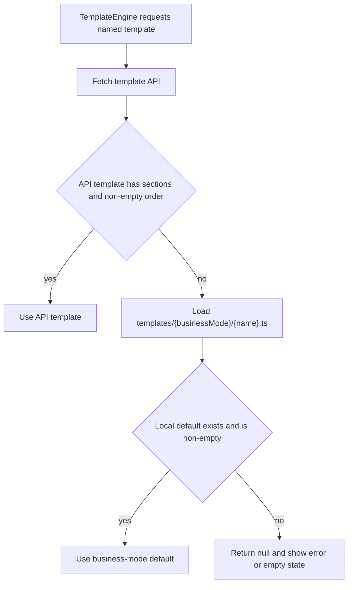
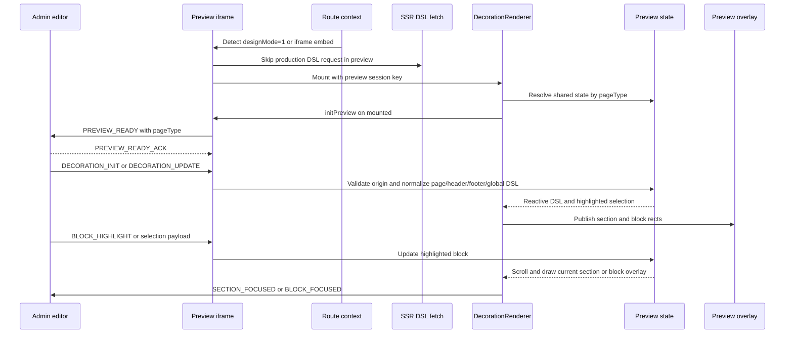

# Decoration And Template Rendering

The application has two configuration-driven rendering systems. The older `TemplateEngine` loads a named template and falls back to a business-mode-specific local file. The decoration engine renders a page-shaped DSL, supports layout/page separation, and adds an iframe preview protocol for the administration editor. They share the idea of ordered sections and named overrides, but they do not share the same data contract or lifecycle.

## Two Contracts

### Business-mode templates

`useTemplateWithFallback(name)` starts an SSR-capable `useTemplate(name)` request to `templateApiClient.getTemplateConfig(name)`. The API result is accepted whether the payload is in `response.data` or is the response object itself. A request failure is converted to `null`, so the fallback can decide what to render without propagating the API exception through the page.

A template is valid only when it is non-null, has `sections` and `order`, and has a non-empty array for `order`. An empty array, `null`, a missing field, or a malformed order therefore cannot suppress the local default. The default loader maps the public runtime business mode to `b2c` or `bbc`; the historical `b2b` value is normalized to `bbc`, and an unset mode defaults to `b2c`. It dynamically imports `app/templateEngines/templates/{mode}/{name}.ts`. If the API value is invalid and a local module exists, the local value wins; if neither is available, the composable returns `null` and the `TemplateEngine` shows its error or empty state.



This flowchart shows how API validity, not merely HTTP success, controls the fallback.

`TemplateEngine.vue` renders `template.order` in order. For each key it first checks for a parent slot with that exact name; a matching named slot replaces the configured component. Otherwise it looks up `template.sections[key].type` in its auto-discovered `sections/*.vue` module map, passes the section fields except `type`, and renders the async component. Missing section data or an unknown component type is logged and skipped. This is a named-slot override, not a merge: the slot completely owns that section's output.

### Decoration DSL

The decoration contract is explicitly page-scoped:

```ts
{
  pageType: 'home' | 'list' | 'product_list' | 'detail' | 'custom' | 'header' | 'footer' | 'global',
  pageId: string,
  sections: Record<string, DecorationSection>,
  order: string[]
}
```

Each section has a `type`, title, disabled flag, settings, keyed blocks, and `block_order`. `order` is the authoritative section render order; section IDs in `order` address entries in `sections`. `pageId` may be an empty string in the normalized type guard, but it must still be a string. The renderer does not infer ordering from object-key order.

`normalizeDecorationDSL` rejects values without the page identity, sections object, or order array, then copies sections and canonicalizes both transport spellings for block order: a non-empty `block_order` is preferred, otherwise `blockOrder` is used. The fetch adapter also accepts JSON strings, arrays of candidate rows, `{ dsl: ... }` wrappers, and row `config` values. A row-shaped legacy object with `sections` and `order` receives fallback `pageType` and `pageId` before normalization. Invalid candidates become `null` rather than being rendered as partial DSL.

## Fetch And Page Selection

`useDecorationPageDslFetch` is the page entrypoint. It delegates to `useDecorationDslFetch` with the same `pageType` and optional `pageId` that the page uses for preview. The fetch is SSR-capable through `useAsyncData` and calls `GET /wxapp/pctemplate/getTemplateContent` with `skipAuth: true` and `skipDistributorId: true`. It sends `page_type` and the current API country code; only `custom` additionally sends `page_id`.

The async-data key is `decoration-dsl-{countryCode}-{pageType}-{pageId}`. Consequently, page identity and locale are cache boundaries, not descriptive metadata. The default page ID is the page type, while the home page explicitly uses `home`; the custom route derives its ID from `route.params.id` (falling back to `route.query.pageId`). A new page must add or reuse a `PageType`, pass a stable page ID when the backend distinguishes instances, and use that same page type for preview state and renderer session identity.

The fetch layer checks the shared preview-route predicate before calling the API. On a `designMode=1` route, or when the browser URL contains that query in a fallback location, the fetch returns `null`. `useDecorationRouteContext` additionally treats an iframe embed as preview when the parent did not propagate the query into the child document. This distinction matters: the SSR DSL is the production/request data source, whereas an active preview receives its current DSL from the admin window.

## Registry, Splitting, And Overrides

The Nuxt decoration plugin provides a `decorationRegistry` mapping section type names to Vue components. Current registered names include `announcement-bar`, `header`, `footer`, `carousel`, `main-carousel`, `image-hotspot`, `product-shelf`, and `product-tab-shelf`. Adding a DSL section type requires a component and a registry entry; a DSL section ID can be arbitrary, but its `type` must resolve to a registered component unless a parent supplies a named slot.

`DecorationRenderer` iterates `dsl.order`, skips disabled sections through `shouldRenderSection`, and resolves each section from the registry. Named-slot precedence is exact and earlier than registry resolution: if the parent exposes a slot whose name equals the section ID, that slot renders instead of the registry component. This is how the collections page keeps its native `product_list` implementation while still participating in decoration ordering and preview selection. The slot is a replacement, not an additive wrapper.

`DecorationSectionHost` adds preview-only section boundaries and rect tracking. `DecorationBlockHost` does the equivalent for blocks, suppressing normal navigation on click in preview, tracking hover and selection, and reporting geometry. Outside preview both hosts are transparent wrappers around their slots.

For pages using the shared layout, `useHomeDecorationSplit` (the name is historical and reusable for any compatible page type) selects the active page DSL and optional global/header/footer preview DSLs. In production it uses `ssrDsl`; in preview it prefers `previewPageDsl` over legacy single `previewDsl`. Header candidates come from the explicit header DSL, then global DSL, then page DSL; footer candidates follow the same precedence and are restricted to the `footer` section. The page renderer removes sections whose type is `header`, `footer`, or `announcement-bar`. Thus layout sections are not accidentally rendered twice in the central page area.

## Preview Session Lifecycle

The preview composable stores one shared state set per page type: legacy `dsl`, split `pageDsl`, `headerDsl`, `footerDsl`, `globalDsl`, and the highlighted block. `DecorationRenderer` computes preview as route/embed preview OR an explicit `isPreview: true`; a false prop cannot override an active route. The `previewSessionKey` must match the page type passed to `useDecorationPreview`. This is especially important when a global payload carries a `pageType` such as `global` but is displayed by a `home` page: the session key must remain `home` so rects, pinned sections, and overlays use the same store.



This sequence shows the preview handshake and update path; it is separate from SSR fetching and does not turn preview messages into server data.

`useDecorationPreview` accepts messages only from configured `decorationAdminOrigins`, with a development-only loopback allowance when no origins are configured. It derives the target origin from the embedding document referrer when possible, supports multiple configured admin origins, and uses the parent window only when the page is actually framed. `PREVIEW_READY` is retried every 250 ms up to 20 attempts until an acknowledged page type is received. Initialization also reports scroll positions. `DECORATION_INIT` and `DECORATION_UPDATE` normalize split payloads and retain a legacy single-DSL state for older consumers; selection is changed only when the payload explicitly carries selection data. The composable removes message, scroll, and retry listeners on unmount.

Preview interactions are intentionally editor-facing. Section and block hosts report viewport-adjusted rectangles; clicks send `SECTION_FOCUSED` or `BLOCK_FOCUSED`, and editing controls can request add, move, duplicate, or remove operations through typed postMessage events. Renderer-level capture prevents links and form submissions from navigating the preview frame. Highlighted section/block state is consumed by the renderer to locate the corresponding `data-decoration-section` or `data-decoration-block` element and keep the editor overlay aligned.

## Defaults And Operations

Decoration defaults are factories rather than API responses. `createDefaultHomeDecorationDsl` supplies the home page's baseline `main-carousel`, `image-hotspot`, and `product-tab-shelf` sections; header and footer factories supply their respective layout DSLs. The home page uses its default only when the fetched/rendered page DSL has no sections. Layout defaults are applied by the shop layout decoration composable for missing header/footer data. These defaults preserve a usable storefront while leaving valid remote configuration authoritative.

For a legacy template, configure `NUXT_PUBLIC_BUSINESS_MODE` as `b2c` or `bbc`; `b2b` remains a compatibility alias for `bbc`. Ensure the corresponding `{name}.ts` file exists when fallback is required. For decoration preview, configure `decorationAdminOrigins` through the public runtime configuration in production so untrusted windows cannot drive the iframe. Keep the page type, page ID, `preview-session-key`, and `useDecorationPreview(pageType)` aligned; mismatches commonly present as missing updates, wrong overlays, or rectangles stored under another page's state.

## Focused Verification

The most relevant tests are contract-oriented. `app/decoration-engine/components/decoration-core.test.js` checks the DSL and message types, block-order normalization, registry names, ordered/disabled renderer behavior, and preview message handling. `decoration-section-contracts.test.js` verifies section components consume `block_order`, use `DecorationBlockHost`, preserve product ordering, and keep header/footer settings and layout behavior. `app/pages/index-decoration-integration.test.js` checks that home and custom pages use the shared fetch/preview path, custom IDs reach the backend, country code scopes cache keys, origins are validated, and the old local decoration proxy is absent. `default-decoration-dsl.test.js` verifies default factories are wired into home and layout fallback. Template fallback behavior is covered structurally by `TemplateEngine.vue`, `useTemplate.ts`, and the template README: changes should preserve API validity checks, mode normalization, exact named-slot precedence, and the no-template error/empty states.

When extending the system, test the boundary you changed: normalization and cache-key behavior for fetch changes, registry and `order`/disabled behavior for new section types, named-slot replacement for native sections, and origin/page-type/session behavior for preview protocol changes.
