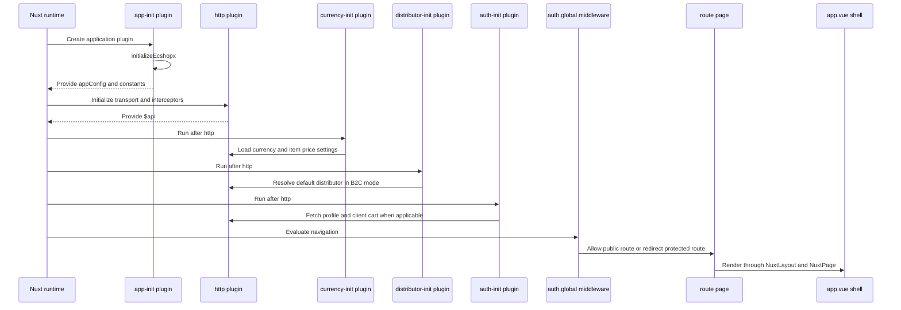
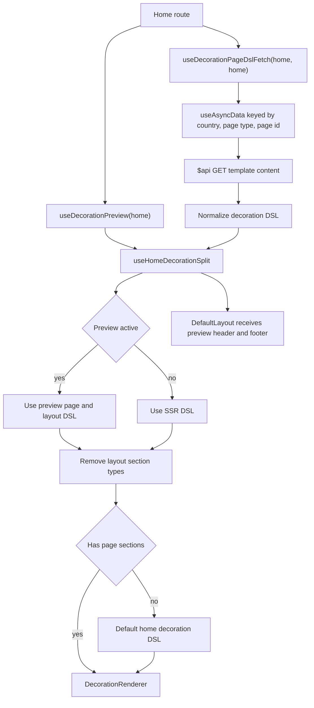

# System Architecture And Source Map

ECSHOPX is a Nuxt 4 application with Vue 3, Pinia, Nuxt UI, and Nuxt i18n. Its source root is `app/` (`srcDir: 'app'`), so the principal runtime boundaries are Nuxt pages and layouts, plugins and middleware, composables and stores, infrastructure clients and transformers, and shared types and value objects. The application is a storefront with account, cart, order, product, collection, custom-page, and decoration domains.

The important architectural rule is that each layer owns a different kind of decision:

- **Pages and components** compose route-specific UI and user interactions.
- **Composables** coordinate page data, async lifecycle, route context, and reusable workflows.
- **Pinia stores** own cross-component state and state transitions such as authentication, cart, and default distributor readiness.
- **HTTP clients** name backend operations and return transport/API responses without adding view behavior.
- **Transformers** convert API shapes into domain or UI models as pure functions.
- **Shared types, value objects, and errors** define reusable contracts without depending on a page.

This division reflects recent product history. The changelog records decoration preview and custom-page rendering as a distinct capability, alongside BBC shop pages and distributor-aware item requests, while commerce work continues separately in cart, checkout, account, product, and order domains. Those changes explain why decoration configuration, business-mode behavior, and commerce data should not be collapsed into one generic page-data mechanism.

## Runtime Boundaries

`app/app.vue` is the outer Vue shell. It mounts `UApp`, the Nuxt loading indicator, `NuxtLayout`, and `NuxtPage` with bounded keep-alive behavior. It also owns the client-only DOM adjustment used when a decoration preview is embedded in an iframe or has `designMode=1`: the route watcher adds or removes `decoration-preview-hide-scrollbar` on the document root and cleans it up before unmount.

`app/index.ts` is a small application entry module, not the Nuxt renderer. It exports application constants and types and exposes `initializeEcshopx`, which is called by `app/plugins/app-init.ts`. That plugin injects `appConfig` and `constants` into the Nuxt app. `app/plugins/bootstrap.ts` registers lifecycle logging hooks for `app:created` and `app:mounted`; it is a lifecycle observer rather than a data owner.

Nuxt discovers plugins and middleware automatically. The HTTP plugin is the dependency anchor for the other initialization plugins: `auth-init`, `currency-init`, and `distributor-init` declare `dependsOn: ['http']`. The global authentication middleware still runs for every navigation, but only redirects route prefixes that require a signed-in user. `init.ts` is a named middleware and has no effect unless a page opts into it.

This sequence shows the startup dependencies. Initialization failures in currency, distributor, profile, and cart are logged and do not all block application rendering; protected-route authorization remains a navigation decision made by the global middleware.

## SSR And Client Split

Nuxt executes setup code in both server and browser contexts, so composables and plugins must explicitly mark browser-only work. The currency plugin runs on SSR and client to keep the currency symbol consistent during hydration. It resets the server symbol, restores a week-long `frontend-currency-cache` cookie when present, then refreshes currency and item-price settings. User profile retrieval and cart loading are client-only in `auth-init`; the user store itself initializes its token and refresh token from cookies, making authentication state available to middleware without requiring a server profile fetch.

The HTTP plugin selects `apiBaseInternal` for SSR when configured, otherwise the public `/api` base. This avoids routing server-side requests through a public loopback path. It applies a ten-second timeout and retries selected transient status codes three times. Its request interceptor adds the bearer token unless `skipAuth` is set, injects `company_id` and locale-derived `country_code`, and injects `distributor_id` only for B2C requests that do not already contain a real store ID. GET parameters stay in `query`; non-GET payloads default to form-urlencoded, while `useJson`, `FormData`, and `Blob` preserve their respective contracts.

The same client normalizes transport and business failures. HTTP statuses become typed `HttpError` values, business responses with an error `status_code` become business errors, client-side 401 responses navigate to the localized login page, and client-side errors may produce localized toast messages. Successful responses with a data object are unwrapped before callers receive them. API clients therefore remain thin operation adapters, while the plugin is the single cross-cutting transport policy boundary.

## Representative Page Data Loading

The home page at `app/pages/index.vue` is a representative composition boundary. It fixes `pageType` and `pageId` to `home`, obtains preview state from `useDecorationPreview`, fetches production DSL through `useDecorationPageDslFetch`, and passes all sources through `useHomeDecorationSplit`. The page renders the central DSL with `DecorationRenderer` and passes preview-only header/footer DSL into `DefaultLayout`; it disables the default Nuxt layout wrapper because it mounts `DefaultLayout` explicitly.

`useDecorationPageDslFetch` delegates to `useDecorationDslFetch`, which uses SSR-capable `useAsyncData` to call `GET /wxapp/pctemplate/getTemplateContent`. The request is unauthenticated and explicitly skips distributor injection because a template is not store-scoped. The cache key includes API country code, page type, and page ID. The adapter accepts response wrappers, JSON strings, candidate arrays, and row `config` values, then normalizes valid DSL and returns `null` for invalid candidates. Preview routes skip the production fetch because their live source is the admin iframe message protocol.

`useHomeDecorationSplit` chooses SSR DSL in production and preview page DSL in an active preview. It removes `header`, `footer`, and `announcement-bar` sections from the central page renderer so shared layout sections cannot render twice. If the page DSL has no sections, the home page uses `createDefaultHomeDecorationDsl` as a usable local fallback.

This flow represents the supported page contract: the same page type must be used for backend fetch identity, preview state, session keys, and renderer/layout coordination. Custom pages reuse the same composables but derive `pageId` from the route, while collections and product pages combine decoration with native commerce sections through page-level composition.

## Page Domains And State Ownership

Pages are route composition units, not general-purpose data stores. Account pages use auth and account composables and are protected by the global middleware. Cart and checkout pages use cart, address, payment, coupon, and order flows. Product and collection pages use product/item clients and may carry an explicit `shopid` or distributor context. Shop and custom pages use route-specific page IDs and decoration while preserving commerce-specific components where needed.

Pinia stores own state that must survive component boundaries or be coordinated across workflows. `useUserStore` restores tokens from cookies, exposes login state, transforms login responses through `AuthTransformer`, fetches the profile once per shared task, and synchronizes the cart after login. `useCartStore` owns cart loading and local reset behavior. `useDistributorStore` separates a soft cookie hydration from authoritative readiness: cached IDs can support a request, but only `fetchDefaultDistributor` marks the store loaded after the `is_valid` backend lookup completes.

Business mode is a commerce boundary. `NUXT_PUBLIC_BUSINESS_MODE` defaults to `b2c`; the HTTP plugin maps historical `b2b` to BBC behavior and injects a default distributor only in B2C. `distributor-init` exits immediately for BBC, because attaching a default online store to BBC requests can produce invalid data. A missing distributor is represented as `0` internally but is never sent as a request parameter; callers can also provide a real ID or opt out with `skipDistributorId`.

## Infrastructure And Shared Contracts

The HTTP client index is the operation map for backend access: auth, cart, item, template, order, payment, address, coupon, distributor, store, upload, and related clients are exported from `app/infrastructure/http/clients/index.ts`. A client resolves Nuxt's injected `$api` lazily, which keeps singleton exports SSR-safe. Clients return raw API results and should not import UI components or decide how a page renders.

The transformer index is the boundary between backend payloads and application models. Cart, product, auth, order, coupon, registration, favorite, and distributor transformers are pure conversion functions. The distributor store demonstrates the intended path: `DistributorApiClient` performs transport, `DistributorTransformer.toDefaultDistributor` creates the application model, and the store owns lifecycle and error state. Shared exports in `app/shared/index.ts` provide value objects and error classes for code that needs stable domain semantics without importing a page or component.

Components should receive domain/UI models and emit user-facing events. A new backend response shape should normally be handled in a client type and transformer, not by spreading API-specific fields through many components. A new cross-page workflow belongs in a composable or store according to whether it is coordination-only or persistent shared state.

## Configuration And Extension Points

`nuxt.config.ts` defines the operational boundaries: `NUXT_APP_BASE_URL` controls the Nuxt base URL, `NUXT_INTERNAL_API_BASE` and `NUXT_API_BASE` select server and public API bases, `NUXT_PUBLIC_COMPANY_ID` and `NUXT_PUBLIC_DEFAULT_COUNTRY_CODE` set global request context, and `NUXT_PUBLIC_DECORATION_ADMIN_ORIGINS` constrains preview messages. `NUXT_PUBLIC_DECORATION_ADMIN_ORIGINS` must be configured for production preview embedding so only trusted admin origins can drive the iframe. The `designMode=1` home route is configured with `ssr: false`; normal pages retain SSR unless another route rule changes it.

To add a page domain, define its route page and keep route-specific orchestration in composables. For a decoration page, add or reuse a `PageType`, pass a stable `pageId`, use the same page type in `useDecorationPreview`, and align `preview-session-key` values. To add a decoration section, define the section contract, register its type in the decoration registry, and test ordered rendering, disabled behavior, and preview hosts. To add a backend operation, add an API client method, transform the response if it crosses into a domain/UI model, and cover the request contract without moving global parameter policy into the page.

## Focused Validation

Run `pnpm test` for the Vitest suite and use `pnpm lint` for static checks. The highest-value tests are boundary tests rather than snapshots:

- `app/pages/index-decoration-integration.test.js` verifies home and custom pages use the shared decoration fetch/preview path, custom IDs reach the backend, country code scopes cache keys, preview origins are derived safely, and removed local decoration proxy routes stay absent.
- `app/infrastructure/http/clients/ItemApiClient.spec.ts` verifies category parameter mapping and ensures invalid `distributor_id` values are omitted while real IDs are forwarded.
- Decoration engine tests verify DSL normalization, registry resolution, ordered/disabled section rendering, block order, and preview messaging.
- Currency, distributor, locale, form-body, and company utility tests protect the global request context that can otherwise cause SSR/client divergence or cross-store data leakage.

When changing startup ordering, test plugin dependencies and SSR/client behavior. When changing request policy, test GET, form, JSON, `FormData`, auth, locale, company, and B2C/BBC distributor cases. When changing decoration, test production SSR, design-mode fetch suppression, preview message validation, page/layout splitting, and fallback defaults together.
