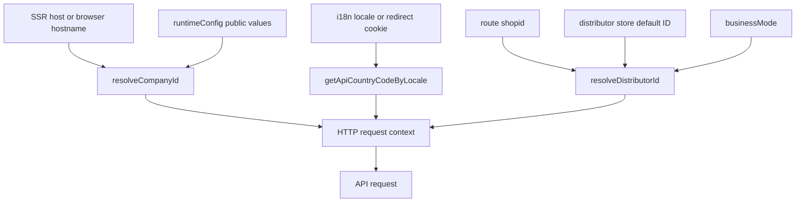

# Runtime Domains And Core Models

This page describes the contracts that sit between runtime configuration, HTTP requests, API payloads, and application-facing models. The recurring design is to normalize external values at an edge, then pass a constrained representation through the rest of the application.

## Runtime context

Three pieces of context travel with most requests:

- **Company** identifies the tenant. On SSR, `resolveCompanyId` reads `x-forwarded-host` first and then `host`; on the client it reads `window.location.hostname`. Only a PC-style `s<digits>.<domain>` host is parsed, for example `s134.shopex123.com` becomes `134`. Other hosts use `runtimeConfig.public.companyId` as the fallback.
- **Country** is derived from the current locale. The HTTP plugin reads the i18n locale, falling back to the `i18n_redirected` cookie, and maps it through the locale registry before injecting `country_code`.
- **Distributor** is a store context only when the business mode is B2C. A valid explicit ID wins; otherwise B2C uses the distributor store’s default ID. BBC deliberately has no default-store fallback.

*The request context flow shows which runtime sources feed the HTTP request and where business mode changes distributor resolution.*

### Business modes

`getBusinessMode()` exposes only `'bbc' | 'b2c'`. The public runtime setting defaults to `b2c`, and the historical value `b2b` is normalized to `bbc`. This normalized mode selects local template directories and is also consumed by cart, checkout, recommendation, and distributor initialization code.

The distinction is behavioral, not just naming:

| Mode | Default distributor behavior | Other implications |
| --- | --- | --- |
| `b2c` | Use an explicit positive ID, otherwise the default online distributor from the Pinia store. | `distributor-init` hydrates a cache and refreshes the default distributor. Global HTTP injection may add the ID. |
| `bbc` | Use an explicit positive ID, otherwise return `'0'`; do not use the B2C default store. | The HTTP layer omits automatic distributor injection, because sending a store ID can produce incorrect data. |

`b2b` must be treated as a compatibility input, not a third operating mode. Any new mode-dependent code should branch on the normalized result from `getBusinessMode()` or apply the same compatibility rule.

### Company and distributor resolution

`parseCompanyIdFromHost` is intentionally a narrow parser: it lowercases the host, removes a port, and accepts only the leading `s` plus digits followed by a dot. It returns the supplied fallback for empty, localhost, custom, or otherwise non-matching hosts.

`resolveDistributorId` normalizes an input through numeric conversion. Non-finite, zero, and negative values become `'0'`; positive values become their canonical decimal string. In B2C, `'0'` then triggers the distributor store fallback. In BBC it remains `'0'`. `resolveDistributorIdNumber` converts the final string back to a number and uses `0` when no valid ID exists.

The HTTP plugin applies this contract defensively:

- `skipDistributorId` disables automatic injection.
- An existing positive `distributor_id` is never overwritten.
- B2C injection may use the route `shopid` before the store default.
- The placeholder `'0'` is not sent over HTTP while the default store is unavailable.
- Decoration template requests set `skipDistributorId: true` because home and template content are not store-scoped.

The distributor initialization plugin runs only in B2C. It soft-hydrates from the current or legacy cookie, then forces a fresh `is_valid`-aware fetch; cache hydration does not mark the store as loaded. Failed initialization is logged and leaves later request resolution able to return `'0'` until a real store is available.

## Locale and country routing

`LOCALE_DEFINITIONS` is the authoritative registry for application locale codes, translation files, display names, and API country codes:

| Application code | Translation file | API `country_code` |
| --- | --- | --- |
| `en` | `en-US.json` | `en-CN` |
| `zh` | `zh-CN.json` | `zh-CN` |
| `ar` | `ar.json` | `ar-SA` |
| `zhtw` | `zh-TW.json` | `zh-TW` |
| `ja` | `ja-JP.json` | `ja-JP` |
| `ru` | `ru-RU.json` | `ru-RU` |

`zh` is the default locale. Normalization trims and lowercases input, preserves exact registered codes first (important for the non-standard `zhtw` code), and otherwise strips a hyphenated region suffix. Unknown, empty, or missing values map to the default API country code `zh-CN`.

The decoration DSL fetcher includes the mapped country code in its cache key and request query. Consequently, locale changes produce a different template cache entry. The HTTP plugin independently applies the same mapping to ordinary requests unless a request already supplies `country_code`.

## Money and quantity value objects

### Money

`MoneyValueObject` is immutable and stores a non-negative amount in **yuan-like major currency units**, not integer cents. Construction rounds to two decimal places with `Math.round(amount * 100) / 100`; negative amounts throw. `amount` returns the rounded number and `display` delegates to `formatMoneyYuan`, producing the application’s currency-formatted string.

All arithmetic returns a new value object. Addition, multiplication, and division are rounded by construction; subtraction can fail when it produces a negative result. Division by zero throws. Comparisons operate on the normalized numeric amount, so equality is value equality rather than object identity.

The API cart contract is different at its edge: cart prices may arrive as strings or numbers representing cents. `CartTransformer.toModel` parses those cents and divides by `100` before creating `MoneyValueObject` instances. This conversion is the boundary that prevents cent-based API values from being mistaken for yuan in the application model.

### Quantity

`QuantityValueObject` is immutable, integer-only, and bounded. Its default range is **1 through 9999**, while callers can provide a custom inclusive `min` and `max`. Construction rejects values below the minimum, above the maximum, or non-integers. `add`, `subtract`, `increment`, and `decrement` all create a new object and revalidate the same bounds.

Cart transformation uses the API quantity and stock as `QuantityValueObject.of(apiItem.num || 1, 1, apiItem.store || 0)`. Therefore the cart model’s quantity is constrained to at least one and at most available stock. A zero stock value produces a maximum of zero and can make the fallback quantity invalid; stock-bearing API data must therefore be interpreted carefully before constructing a quantity. Quantity changes should go through the value object so boundary failures remain explicit rather than silently clamping values.

## API, HTTP, and cart models

`ApiResponse<T>` is the current generic business response shape: `status_code`, `message`, and `data`, with optional timestamp and trace ID. The compatibility `IApiResponse<T>` uses the same required fields but permits a string timestamp and `request_id`. `status_code` value `0` is documented as business success in the type contract, but consumers must still follow the actual HTTP client behavior and endpoint contract.

HTTP options expose explicit context escape hatches: `skipAuth`, `skipCompanyId`, and `skipDistributorId`, plus request method, query, body, headers, timeout, and form-versus-JSON selection. `UseHttpReturn<T>` models reactive request lifecycle state with nullable `data`, `pending`, `error`, `refresh`, and `execute`.

Errors distinguish transport and business concerns. `HttpError` extends `Error` with an `ErrorType`, business code, HTTP status, request metadata, details, and a retry hint. The HTTP plugin maps 401 to authentication, 403 to permission, 422 to validation, 5xx to server, and other non-special statuses to HTTP errors. Business-response failures become `BUSINESS_ERROR` with `retry: false`; retryable transport statuses are 408, 429, 500, 502, 503, and 504.

The cart has two deliberate representations:

1. `ICartItem` and related API types preserve wire names such as `cart_id`, `item_id`, `price`, `num`, `store`, and `is_checked`. Cart add requests require `item_id`, `num`, `distributor_id`, a `cart_type` of `cart` or `fastbuy`, and a supported `shop_type`.
2. `ICartItemModel` is the application model. It uses `MoneyValueObject` for sale, market, optional promotional, and effective prices; `QuantityValueObject` for quantity; and normalized names such as `productId`, `productName`, `stock`, and `selected`.

`CartTransformer` is a pure boundary adapter: it parses and cleans API data, supplies defaults, resolves effective pricing, and constructs value objects. It does not own cart business rules, display formatting, or aggregate calculations. Those responsibilities remain with value objects and cart composables/stores.

## Page and render DSLs

The decoration DSL is an ordered page document:

- `DecorationDSL` has `pageType`, `pageId`, a keyed `sections` map, and a section `order` array.
- Each `DecorationSection` has a type, title, disabled flag, settings, keyed blocks, and `block_order`.
- Each `DecorationBlock` has a type, optional disabled flag, and arbitrary settings.
- Supported page types are `home`, `list`, `product_list`, `detail`, `custom`, `header`, `footer`, and `global`.

`isDecorationDSL` checks the structural minimum: an object with a page type, string page ID, object sections, and an array order. An empty `pageId` is valid because the backend decoration store uses it as a default. The predicate does not validate every nested section or block field.

`normalizeDecorationDSL` is the compatibility boundary for block ordering. It accepts either `block_order` or legacy/camel-case `blockOrder`, prefers a non-empty snake-case array, removes both source keys, and returns the canonical `block_order` shape. Invalid input returns the supplied fallback, normally `null`. `hasDecorationSections` means only that the top-level `order` array is non-empty; it is not a deep content validator.

The fetch path extracts JSON encoded in a response, unwraps a `dsl` property when present, accepts the first suitable array entry, normalizes the document, and supplies `pageType` or `pageId` fallbacks when a partially shaped document contains sections and order. It does not fetch while decoration preview is active. Requests are keyed by country, page type, and page ID, and custom pages include `page_id` in the query. API template configuration follows a similar resilience rule: an API template is used only when it has non-empty `order` and `sections`; otherwise the mode-specific local template is used, with `null` returned when neither is available.

## Safe change checklist

- Normalize `b2b` to `bbc` at the boundary and keep downstream branches to `bbc` and `b2c`.
- Treat money inputs as cents only where the API contract says so; convert to major units before constructing `MoneyValueObject`.
- Preserve non-negative, two-decimal money semantics and do not mutate value objects.
- Keep quantity limits inclusive and validate stock-derived maxima before constructing cart quantities.
- Do not inject a distributor ID into BBC requests, decoration-template requests, or any request explicitly using `skipDistributorId`.
- Never send distributor ID `'0'` as if it were a real store.
- Add a locale definition when introducing a locale so translation file, normalized code, and API country mapping remain aligned.
- Preserve both DSL input spellings only at the normalization edge; use canonical `block_order` internally.

## Focused tests

The existing focused tests cover the most failure-prone boundaries:

- `app/utils/resolveDistributorId.spec.ts` verifies explicit IDs, B2C fallback, BBC no-fallback behavior, and the `'0'` result when no store is available.
- `app/shared/localeConfig.spec.ts` verifies case normalization, exact `zhtw` handling, the `ja` and `ru` mappings, default mappings, and non-default locale registration.
- `app/utils/company.spec.ts` verifies forwarded-host parsing, ports, casing, host rejection, and fallback behavior.

Changes to value-object bounds, cart cent conversion, HTTP context injection, or DSL normalization should add or update focused unit tests for the boundary and its failure behavior rather than relying only on page-level tests.
