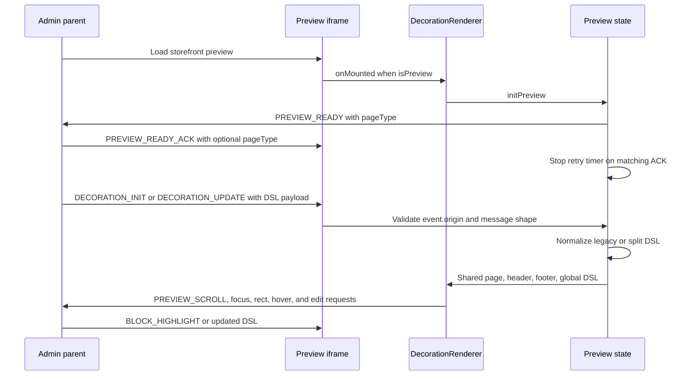
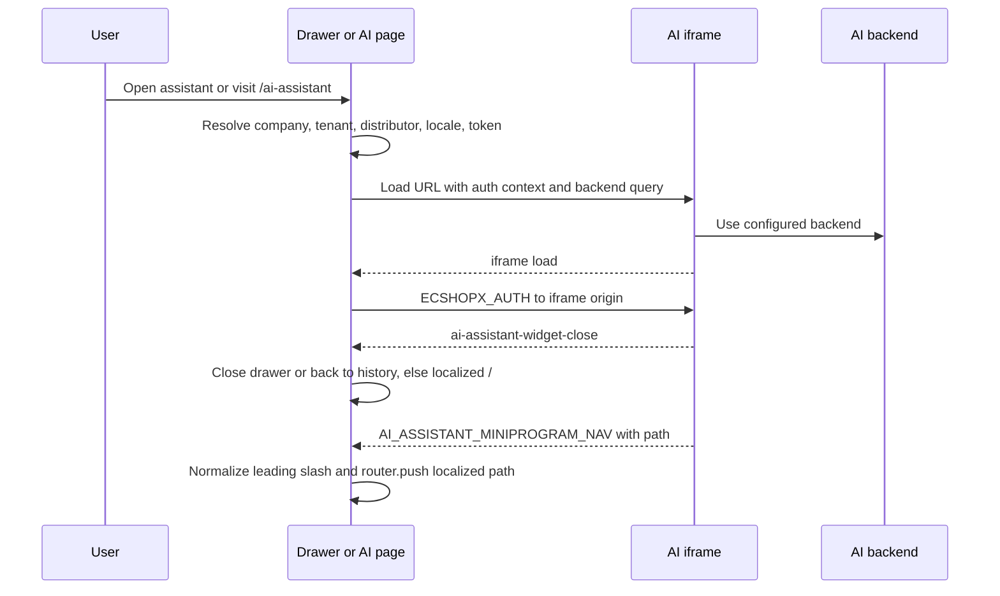

# Admin Preview And AI Assistant Integrations

This application has two browser integrations that cross an iframe boundary:

- **Decoration preview** is an editor-controlled storefront iframe. The admin sends decoration DSL updates and editing commands travel back to the admin.
- **AI assistant** is a separately hosted embed used either in the default-layout drawer or on the `/ai-assistant` page. The storefront supplies authentication and tenant context, then accepts close and navigation events from the embed.

These are separate protocols. Do not reuse the generic `usePostMessage` channel abstraction for them without preserving the origin rules described below: that helper filters by channel but its listener does not enforce `event.origin`.

## Configuration And Trust Boundaries

The browser receives these values through Nuxt public runtime configuration (`nuxt.config.ts`):

| Variable | Runtime field | Role |
| --- | --- | --- |
| `NUXT_PUBLIC_DECORATION_ADMIN_ORIGINS` | `decorationAdminOrigins` | Comma-separated admin origins trusted to send preview control messages. |
| `NUXT_PUBLIC_AI_ASSISTANT` | `aiAssistant` | Enables the AI assistant only for `true`, `1`, or the string `"true"` (also numeric `1`). |
| `NUXT_PUBLIC_AI_BASE_URL` | `aiBaseUrl` | Default AI host for the embed page and backend fallback. |
| `NUXT_PUBLIC_AI_ASSISTANT_BACKEND_URL` | `aiAssistantBackendUrl` | Optional backend override used by the embed URL and widget configuration endpoint. |
| `NUXT_PUBLIC_AI_EMBED_PAGE_URL` | `aiEmbedPageUrl` | Explicit embed HTML URL; a URL without an `.html` suffix gets `/index.html`. |
| `NUXT_PUBLIC_AI_TENANT_ID` | `aiTenantId` | Tenant application identifier sent as `tenant_app_id` in the URL and `tenantId` in the auth message. |

The checked-in `.env.example` uses `http://localhost:8080` and `https://{host_name}` as decoration-admin examples and separate placeholders for the AI host, backend host, and tenant. Public variables are intentionally available on both client and server, so tokens and other sensitive context must be handled as integration data rather than treated as secret configuration.

## Decoration Preview Protocol

### Entry point and state ownership

`DecorationRenderer` calls `initPreview()` after mounting when its computed `isPreview` is true, and retries the call if that state changes to true. `useDecorationPreview` owns the browser message listener, the handshake retry timer, scroll reporting, and page-scoped shared state. Its `useState` keys prevent multiple composable consumers on one page from receiving separate DSL or highlight copies.

A decoration message has a `type` and object `payload`. The accepted DSL forms are:

- Legacy single-document payload: `dsl`, optionally carrying `pageType` and `pageId`.
- Split payload: `pageDsl`, `headerDsl`, `footerDsl`, and optional `globalDsl`.

Each DSL is normalized at the boundary. `normalizeDecorationDSL` requires a page type, string page ID, object sections, and an order array, and converts either `block_order` or legacy `blockOrder` into canonical `block_order`. Invalid DSL is ignored. A split payload also updates the legacy `dsl` state for existing consumers; a legacy global document can be partitioned into non-footer and footer subsets.

### Origin validation

Incoming preview messages are accepted only when their `event.origin` is trusted:

1. If `decorationAdminOrigins` is non-empty, the origin must exactly match a configured origin.
2. In development, a configured loopback origin may match another loopback hostname (`localhost`, `127.0.0.1`, `0.0.0.0`, or `[::1]`) when protocol and port also match. This accommodates local host aliases without weakening production checks.
3. If no origins are configured, only a development HTTP(S) loopback origin is accepted. Production therefore accepts no incoming preview control messages without explicit configuration.
4. Messages must be objects with a `type`; malformed data is ignored.

Replies use the parent window’s origin when it can be safely derived from `document.referrer` and that referrer is allowed. With no single usable configured origin, the preview cannot select a specific configured target. `postToParent` uses `*` in development and as a production fallback when no target is available, but this applies to outbound preview notifications; it does not bypass the incoming-origin gate.

### Handshake and message flow



*The preview handshake, origin gate, DSL synchronization, and editor feedback flow.*

`PREVIEW_READY` is sent immediately and retried every 250 ms until a matching `PREVIEW_READY_ACK` arrives or 20 retries have been attempted. The retry timer and message/scroll listeners are removed during unmount. The preview never sends the handshake during SSR or when it is the top-level window rather than an iframe.

### Message catalog

**Admin to preview**

- `DECORATION_INIT` and `DECORATION_UPDATE`: initialize or replace DSL. The payload may use the legacy `dsl` field or split `pageDsl`, `headerDsl`, `footerDsl`, and `globalDsl`; `selection` or `sections` may carry a selected `{ sectionId, blockId }`.
- `PREVIEW_READY_ACK`: acknowledges the iframe handshake; an omitted page type acknowledges the current page, while a different page type is ignored.
- `BLOCK_HIGHLIGHT`: selects a section and optional block. The implementation accepts camelCase and snake_case IDs and also checks a nested `data` object.

**Preview to admin**

- `PREVIEW_READY` and `PREVIEW_SCROLL` report readiness and `{ pageType, scrollX, scrollY }`.
- `SECTION_FOCUSED`, `BLOCK_FOCUSED`, `SECTION_HOVERED`, and `BLOCK_HOVERED` report editor interaction. Empty IDs represent cleared hover or section-only selection where applicable.
- `SECTION_RECT` and `BLOCK_RECT` report geometry plus the current scroll viewport.
- `ADD_BLOCK_REQUESTED`, `ADD_SECTION_REQUESTED`, `MOVE_SECTION_REQUESTED`, `DUPLICATE_SECTION_REQUESTED`, `REMOVE_SECTION_REQUESTED`, `MOVE_BLOCK_REQUESTED`, `DUPLICATE_BLOCK_REQUESTED`, and `REMOVE_BLOCK_REQUESTED` request editor mutations. Add requests may include insertion index, pointer anchor, and one of `header`, `template`, or `footer` areas.

The preview composable reports events with the current `pageType`; mutation and focus payloads identify the relevant section and, for block operations, block ID. The parent application owns persistence and editor-side interpretation of these requests; the preview owns rendering and measurement state.

## AI Assistant Embed Contract

### Enablement and entrypoints

`BCAiAssistantFab` renders only after client mount, only when the explicit enablement flag is truthy, and not on a route whose path or name contains `ai-assistant`. On mount it fetches `${backend}/api/widget/embed-config`, adding `tenant_app_id` when configured. The response may be wrapped in `data`; avatar settings support snake_case and camelCase. An external URL, an avatar marked `has_icon`, or an icon asset produces an image; otherwise the selected display name, assistant name, or `AI` is used as text. A failed config request leaves the text fallback and does not prevent the assistant from opening.

The FAB emits `open`; the default layout owns the drawer state. The drawer is mounted only when the layout’s `isAiAssistantFeatureEnabled` is true. The `/ai-assistant` page provides a full-height iframe and uses the same embed utilities, but it is not opened by the FAB.

### URL and authentication payload

The embed page URL is resolved in this order: explicit `aiEmbedPageUrl`, `aiBaseUrl/ai-assistant-embed/index.html`, then the relative `/ai-assistant-embed/index.html` fallback. The backend is `aiAssistantBackendUrl` with trailing slashes removed, falling back to `aiBaseUrl`.

Both AI entrypoints build the same payload:

```js
{
  type: 'ECSHOPX_AUTH',
  token,
  companyId,
  tenantId,
  distributorId,
  locale
}
```

`token` comes from `useUserStore`; `companyId` from `resolveCompanyId`; `tenantId` from `aiTenantId`; and `locale` is the API country code from the current i18n locale, not the raw UI locale. `distributorId` is resolved from route query keys in this priority order: `distributor_id`, `distributorId`, `dtid`, `shop_id`; if none is present on a `/shop/:id` route, the route `id` is used. Missing fields become empty strings.

The same values are also placed in the iframe query string when non-empty: `token`, `company_id`, `distributor_id`, `tenant_app_id`, and `locale`. The URL always adds `backend`, `layout=page`, and `page-soft-close=true`. Existing query parameters on an explicit embed URL are preserved. Query-string credentials and the postMessage payload are therefore both part of the external embed contract.

### Authentication, origin filtering, and navigation



*The shared AI embed URL/auth contract and the two navigation outcomes.*

After iframe load, and whenever the user token or locale changes, the host sends `ECSHOPX_AUTH` to the exact origin parsed from `iframeSrc`. It never sends authentication to `*`. The iframe `allow` policy is `clipboard-write; microphone; camera`.

The host listens for `message` only while mounted and rejects messages whose origin differs from the iframe URL origin. It then handles two messages:

- `ai-assistant-widget-close`: the drawer sets its model false; the full page goes back when browser history has more than one entry and otherwise routes to localized `/`.
- `AI_ASSISTANT_MINIPROGRAM_NAV` with a truthy `path`: the host ensures a leading slash, closes the drawer when present, and routes through `localePath`. The page variant routes without a drawer close step.

The host does not validate a richer navigation schema or constrain the path beyond adding a leading slash, so changes to this contract should be reviewed as routing and trust-boundary changes. Listeners are removed on unmount.

## Operations And Safe Changes

- Configure every production decoration-admin origin explicitly in `NUXT_PUBLIC_DECORATION_ADMIN_ORIGINS`; do not rely on the development loopback exception.
- Keep protocol, hostname, and port accurate. A referrer that is not in the configured list causes the preview target-origin computation to return empty, while incoming messages remain rejected unless their origin is allowed.
- Treat `NUXT_PUBLIC_AI_EMBED_PAGE_URL`, `NUXT_PUBLIC_AI_BASE_URL`, and `NUXT_PUBLIC_AI_ASSISTANT_BACKEND_URL` as a coordinated deployment setting. The embed origin is the origin used for both auth delivery and inbound message filtering; the backend URL is a query parameter and widget-config endpoint base, not necessarily the iframe origin.
- Preserve the exact auth field names and mappings. In particular, `tenantId` becomes `tenant_app_id` in the URL, and the application locale becomes an API country code.
- Do not replace explicit AI target origins with `*`, and do not remove the origin check from close/navigation handling.
- When extending preview messages, add the type to `DecorationMessageType`, define its payload invariant, keep the incoming origin gate before dispatch, and clean up any listener or timer added by the feature.
- Preview DSL changes must retain the normalization edge and compatibility with both `block_order` and `blockOrder` unless the admin protocol is versioned together with the storefront.

## Focused Tests

The source-level decoration tests verify that the message type contract includes initialization, readiness, focus, highlight, geometry, and block mutation messages, and that `useDecorationPreview` checks `event.origin`, handles init/update/ready/highlight, posts messages, and exposes split DSL state. The renderer tests verify ordered sections, disabled sections, registry resolution, and highlight scrolling (`app/decoration-engine/components/decoration-core.test.js`).

`app/utils/aiAssistantEmbed.spec.ts` covers enablement values, URL normalization and fallback, backend selection, distributor precedence, empty-string defaults, the complete URL query contract, browser-only opening behavior, and posting auth to an explicit origin. `app/utils/aiAssistantWidgetConfig.spec.ts` covers selected avatar display behavior and assistant-name fallback.

The page and drawer source tests verify that both entrypoints use the shared company, tenant, distributor, locale, URL, and auth utilities, register and remove message listeners, handle close/navigation messages, and do not post auth with wildcard origins. The FAB source test verifies client-only rendering, enablement and route suppression, widget-config loading, fallback handling, and emission of the drawer-open event.
