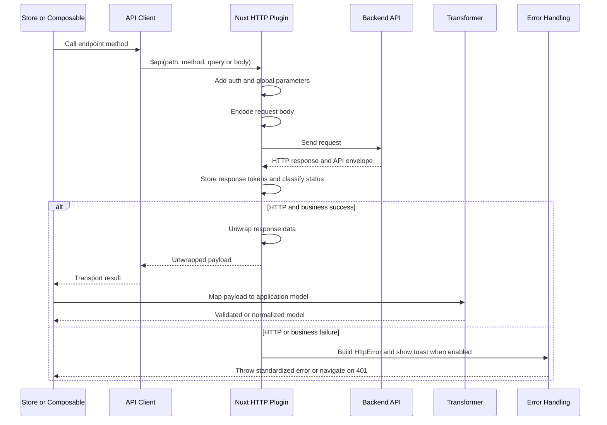

# HTTP Transport And Backend Contracts

## Boundary And Ownership

The integration boundary is `nuxtApp.$api`, provided by `app/plugins/http.ts`. API clients such as `AuthApiClient`, `CartApiClient`, `OrderApiClient`, and `PaymentApiClient` lazily obtain that instance through `useNuxtApp()` and describe endpoint paths, methods, and endpoint-specific payload shaping. They do not own authentication headers, global request parameters, HTTP retries, toast messages, or response-envelope handling. The client layer returns the plugin's result to composables, stores, or repositories.

The transformer layer is downstream of transport. Transformers convert the plugin's unwrapped payload into application models and enforce model-specific validation or defaults. For example, `AuthTransformer.toLoginModel` requires a token, `CartTransformer.toModel` creates money and quantity value objects, and `OrderTransformer.toCalculateModel` converts monetary values from cents to application amounts. A transformer should not be used as a substitute for transport error handling or business rules.

This sequence shows the normal caller-to-backend path and the split between transport normalization and application-model transformation.

## Request Pipeline

The plugin selects the base URL from runtime configuration: on the server it prefers `apiBaseInternal` when configured, otherwise it uses the public `apiBase` and defaults to `/api`. The default timeout is 10 seconds. The plugin logs request method and URL and response status and URL, which provides the basic operational trace for this boundary. Runtime configuration exposes `NUXT_INTERNAL_API_BASE`, `NUXT_API_BASE`, `NUXT_PUBLIC_API_BASE`, `NUXT_PUBLIC_COMPANY_ID`, `NUXT_PUBLIC_DEFAULT_COUNTRY_CODE`, and `NUXT_PUBLIC_BUSINESS_MODE` for these concerns.

Before dispatch, `onRequest` applies these rules:

- Unless `skipAuth` is true, the current `userStore.token` is sent as `Authorization: Bearer <token>` when a token exists. `skipAuth` is useful for intentionally public or bootstrap calls; it does not itself log a user out or refresh a token.
- `company_id` is injected unless `skipCompanyId` is true and a company ID is resolved. `country_code` is injected unless `skipCountryCode` is true and the caller did not already provide one. The country value comes from the current locale or locale cookie, then the configured default, then `zh-CN`.
- `distributor_id` is automatically managed only in B2C mode. A real caller-supplied ID greater than zero is preserved; otherwise the plugin resolves the route `shopid` or default online store. It does not send `0` while the store is not ready. `skipDistributorId` disables this behavior. This matters for cross-store cart aggregation and default-store discovery, which explicitly set `skipDistributorId: true`.
- Global parameters are added to GET `query`, to ordinary non-GET bodies after parsing, and to `FormData` fields. For `FormData`, existing `company_id` and `country_code` fields are preserved and the distributor field is replaced only when distributor injection is needed. A `Blob` is not structurally mutated.

`skipAuth`, `skipCompanyId`, `skipDistributorId`, and the related `skipCountryCode` behavior are transport options, not backend endpoint names. They must be set at the call site when a request has a deliberately different contract.

## Body Encoding

The method determines the default representation. GET requests keep their values in `query`. Non-GET requests default to `application/x-www-form-urlencoded`; the plugin parses an object or existing URL-encoded string, injects global parameters, then serializes it with `URLSearchParams`. `useJson: true` keeps the normalized body as an object and sets `Content-Type: application/json`. `FormData` and `Blob` bodies are left intact and do not receive an automatic content type, allowing the platform or caller to manage multipart or binary boundaries. A caller-provided `Content-Type` is never overwritten.

The form serializer is deliberately shallow: values are converted with `String(value)`. Therefore endpoint clients must shape nested and repeated values before calling `$api`. `OrderApiClient` JSON-stringifies `recommend_item_id` because a generic form serializer would otherwise produce `[object Object]`. `PaymentApiClient` expands voucher images into `voucher_pic[0]`, `voucher_pic[1]`, and so on. Conversely, recommendation matching uses `useJson: true` so its arrays remain JSON data. The `ItemApiClient` tests lock both behaviors down.

## Response Contract

The backend convention is an API envelope with `status_code`, `message`, and `data`. In `onResponse`, the plugin examines `response._data.data`:

- A `status_code` of 400 or greater is a business failure. The plugin creates an `HttpError` with `type: BUSINESS_ERROR`, puts the business code in `error.code`, preserves the envelope in `error.details`, marks it non-retryable, optionally shows a toast, and throws it. `skipErrorCodes` suppresses the global toast for matching business codes but does not make the request successful.
- A data object without a `status_code` is treated as a successful payload by the plugin's compatibility path, then the `data` field is assigned to `response._data`. On success, callers receive the unwrapped payload rather than the outer envelope. Clients and stores consequently pass the result directly to transformers; for example, the user store passes the login result to `AuthTransformer.toLoginModel` and the user-info result to `toUserInfoModel`.
- Response headers named `X-Token` and `X-Refresh-Token` are copied into the `token` and `refresh-token` cookies. This header capture is independent of the body transformer.

The API clients intentionally remain thin. Their endpoint-specific request preparation is still part of the backend contract, such as login field defaults in `AuthApiClient`, cart-wide requests that skip distributor injection, order payload serialization, and payment voucher key expansion.

## Error Classification And Retry

Transport failures enter `onResponseError` and are normalized into `HttpError`:

| Source | `HttpError.type` | Retry flag |
| --- | --- | --- |
| HTTP 401 | `AUTH_ERROR` | true only if the status is in the retry list; 401 is not in it |
| HTTP 403 | `PERMISSION_ERROR` | false |
| HTTP 422 | `VALIDATION_ERROR` | false |
| HTTP 5xx | `SERVER_ERROR` | true for the configured retry statuses |
| Other HTTP response | `HTTP_ERROR` | true only for 408, 429, 500, 502, 503, or 504 |
| Timeout text from fetch error | `TIMEOUT_ERROR` | false |
| Network or fetch text | `NETWORK_ERROR` | false |
| Other thrown fetch error | `UNKNOWN_ERROR` | false |

HTTP error messages prefer `response._data.data.message`, then `response._data.message`, then the HTTP status text. The normalized error retains the response payload in `details`. Unless `skipErrorCodes` contains the HTTP status, the plugin displays a client-only toast and rethrows the error. Business errors are distinct from HTTP errors: a successful HTTP response can still be rejected because its business `status_code` is 400 or greater.

The underlying `$fetch` instance is configured for up to three retries with a one-second delay and retry statuses `[408, 429, 500, 502, 503, 504]`. This automatic policy is transport-level and does not retry business errors. The `retry` flag on `HttpError` describes the same status-based policy for consumers; it is not a signal that an application operation is always safe to repeat.

## 401, Refresh, And Logout Boundary

The plugin's 401 behavior is redirect-oriented, not refresh-oriented. A transport HTTP 401 and a business `status_code` of 401 both navigate the client to the localized `/account/login` route; the plugin does not call `authApiClient.refreshToken()` and does not retry the failed request with a refreshed token. The same navigation behavior is client-only, so server-side handling does not perform browser navigation.

Refresh is an explicit operation: `AuthApiClient.refreshToken()` calls `/wxapp/auth/refresh`, and `userStore.refreshAuthToken()` transforms the response and updates the token. If refresh fails, the store clears login state and both tokens. Logout is also owned by the user store: it clears `isLoggedIn`, user information, tokens, and the local cart without requiring a logout endpoint. Separately, failure while fetching user information clears the same session state. Callers must therefore distinguish transport redirect behavior from the store's explicit refresh and logout lifecycle.

## Transformers And Focused Tests

Use a transformer when a caller needs a stable application model rather than an API-shaped payload. `AuthTransformer` validates required authentication fields and removes the configured invalid avatar sentinel. `CartTransformer` normalizes prices, quantities, store metadata, and promotion tags into cart models. `OrderTransformer` maps checkout items and converts cent-based amounts to application values. These functions are pure mapping boundaries; their failures are model-validation failures after transport has already succeeded.

The highest-value transport tests are small client contract tests. `ItemApiClient.spec.ts` verifies that recommendation matching omits an invalid distributor ID, preserves a real one, and opts into JSON. `PaymentApiClient.spec.ts` verifies the indexed `voucher_pic[n]` form keys and the exact upload call. New endpoint clients should follow the same pattern: assert the path, method, global-option intent, and pre-serialization body shape without duplicating the plugin's runtime behavior in every test.

## Change Guidance

When adding an endpoint, keep the client responsible for endpoint-specific names, defaults, and serialization quirks; rely on the plugin for auth, global parameters, encoding defaults, response unwrapping, error classification, and retries. Use `useJson` when the backend expects structured JSON, explicitly flatten arrays for form-urlencoded contracts, and add a focused client test for the resulting call. When changing the plugin, update the contract tests and verify both a business error inside an HTTP-success envelope and a real HTTP failure, because they take different paths through the interceptors.
