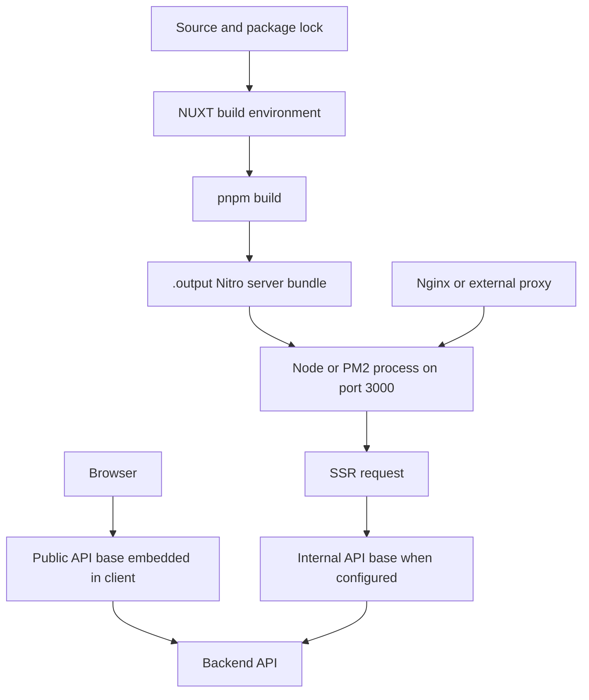

# Configuration, Build, And Deployment Runbook

This application is a Nuxt 4 server-rendered frontend. A production deployment has two distinct phases: `pnpm build` creates the Nitro server bundle in `.output/`, and a Node process runs `.output/server/index.mjs` on port `3000`. The browser then calls the configured public backend base, while SSR requests may use a separate internal backend base.

## Deployment Flow



This flow shows the build-image boundary, generated Nitro output, runtime process, proxy, and the separate SSR and browser API paths.

## Environment And Configuration

Use `.env.example` as the variable inventory. Do not copy production credentials into documentation or commit them to the repository. For local work, copy the example to `.env` and set values for the target backend and tenant.

### Public values are build inputs

Variables with the `NUXT_PUBLIC_` prefix are exposed through `runtimeConfig.public` and are available to both server and browser code. In this project they include the public API base, timeout, company and country defaults, business mode, upload settings, decoration preview origins, and AI assistant endpoints. Because these values are supplied to Nuxt during configuration and are passed as Docker builder arguments before `RUN pnpm build`, changing one requires a new build and a new deployed `.output` or image.

The most consequential setting is `NUXT_PUBLIC_API_BASE`:

- Set it to the backend URL and API prefix the browser can reach, for example `https://your-domain.com/api/h5app` when the backend is exposed through the same public domain.
- When the backend is directly exposed on a non-standard port, include that port in the URL.
- If unset, Nuxt falls back to `/api`, so browser calls go to the frontend host and depend on a proxy route there.
- Do not place credentials or private tokens in any `NUXT_PUBLIC_*` value.

Other public settings should match the target tenant and product behavior. `NUXT_PUBLIC_COMPANY_ID` contributes global request context. `NUXT_PUBLIC_BUSINESS_MODE` defaults to `b2c`; the application normalizes the legacy `b2b` spelling to `bbc` in business-mode helpers. BBC/B2C differences affect distributor handling and UI behavior, so validate the selected mode after deployment. `NUXT_PUBLIC_DECORATION_ADMIN_ORIGINS` must contain only trusted management origins when iframe preview messaging is enabled. AI values should be supplied only when the feature is intended to be enabled.

### Server-only API values

The Nuxt configuration defines a non-public `apiBaseInternal` value from `NUXT_INTERNAL_API_BASE`, falling back to `NUXT_API_BASE`, then an empty string. These names have no `NUXT_PUBLIC_` prefix and are intended for server-side SSR traffic. The HTTP plugin selects the internal base only when `import.meta.server` is true and an internal base is configured; browser requests always use `runtimeConfig.public.apiBase`.

Use this split when the public hostname is routed through Nginx or another proxy that would loop if the frontend made SSR calls back through its own public listener. Set `NUXT_INTERNAL_API_BASE` to a backend address reachable from the frontend process or container, and set `NUXT_PUBLIC_API_BASE` independently to the browser-reachable address. If no internal base is configured, SSR falls back to the public base, and then to `/api` if the public base is also unset. Confirm both paths from the actual network namespace where the Nitro process runs.

The Dockerfiles explicitly pass the public build variables through builder and runner stages, but do not declare the internal API variables as Docker `ARG`s. Supply server-only values through the runtime environment or deployment process and verify the resulting configuration without printing secrets. The Nuxt config currently logs all environment entries whose names start with `NUXT_` during configuration; treat CI and build logs as potentially sensitive and avoid putting secrets in `NUXT_*` values.

## Build And Run

### Local or host build

The repository requires Node `22.23.4` and pnpm `10.13.0` (or a compatible pnpm 10 release). Corepack is enabled by the container images and can be enabled locally as well.

```bash
corepack enable
pnpm install --frozen-lockfile
pnpm lint
pnpm test
pnpm build
node .output/server/index.mjs
```

The generated server listens on `0.0.0.0:3000` by default in the container image. `HOST` and `PORT` can override the listener for a host deployment. `pnpm dev` is for development; it is not the production process.

### Docker

`Dockerfile` and `Dockerfile-Atlas` currently have the same three-stage shape:

1. `base` enables Corepack on the Node `22.23` Alpine image.
2. `deps` copies only `package.json` and `pnpm-lock.yaml`, then runs `pnpm install --frozen-lockfile` for cacheable, locked dependencies.
3. `builder` copies dependencies and source, exports the declared `NUXT_*` build arguments, and runs `pnpm build`.
4. `runner` sets `NODE_ENV=production`, `HOST=0.0.0.0`, and `PORT=3000`, copies only `/app/.output`, exposes port `3000`, and starts Nitro with `node .output/server/index.mjs`.

Build public configuration into the image explicitly. A representative command is:

```bash
docker build \
  --build-arg NUXT_PUBLIC_API_BASE=https://your-domain.com/api/h5app \
  --build-arg NUXT_PUBLIC_COMPANY_ID=1 \
  --build-arg NUXT_PUBLIC_BUSINESS_MODE=b2c \
  -t ecshopx-web:release .
```

Pass the actual values required by the Dockerfile and target environment. Do not put secrets in build arguments because image history and build logs can expose them. Inject server-only runtime configuration through the orchestrator or container environment, then run the image with the required network and proxy settings.

```bash
docker run --rm -p 3000:3000 \
  -e NUXT_INTERNAL_API_BASE=https://backend.internal/api/h5app \
  ecshopx-web:release
```

The internal URL above is a placeholder: use the address reachable from the container, not a copied production secret or an address that routes back to the same frontend container.

### PM2 on a host

After building on the host, `ecosystem.config.cjs` starts the generated Nitro entrypoint in cluster mode with `instances: 'max'`, automatic restart, and port `3000`. It binds `NITRO_HOST` to `127.0.0.1`, which assumes Nginx or another local reverse proxy is the public ingress.

```bash
pnpm install --frozen-lockfile
pnpm build
pm2 start ecosystem.config.cjs
pm2 save
```

Keep the PM2 environment consistent with the build and runtime split. Public values must be present before `pnpm build`; server-only API values must be available to the PM2 process. When changing public values, rebuild before restarting. When changing only runtime server values, restart the process and verify SSR traffic independently.

## Proxy Contract

The frontend listener is an application process, not a complete edge deployment. A proxy or load balancer should forward the public site to `HOST:PORT` (normally port `3000`), preserve the host and request scheme as needed by the deployment, and route the backend API according to the selected public API base. The project documentation specifically assumes Nginx for the PM2 setup.

A common arrangement is:

- Browser requests use `https://public-host/...` and `NUXT_PUBLIC_API_BASE` points to the public backend path.
- Nginx sends frontend page and asset requests to `127.0.0.1:3000`.
- Nitro SSR calls use `NUXT_INTERNAL_API_BASE` to reach the backend directly, avoiding a frontend-to-Nginx-to-frontend loop.

If using a same-origin `/api` public base, the proxy must route `/api` to the backend rather than to Nitro. If using a separate backend hostname, check browser CORS, TLS, cookies, and allowed origins. The backend URL must include the API prefix expected by the endpoint clients; a host-only URL can produce valid-looking but incorrect paths.

## Request And Failure Behavior

The shared HTTP plugin uses a 10-second default timeout unless `NUXT_PUBLIC_API_TIMEOUT` is configured, retries status codes `408`, `429`, `500`, `502`, `503`, and `504` up to three times with a one-second delay, and logs request and response URLs. It adds authentication from the user store unless `skipAuth` is set, and adds company, country, and (in B2C mode) distributor context unless the request opts out. Non-GET bodies default to `application/x-www-form-urlencoded`; `useJson: true` selects JSON, while `FormData` and `Blob` remain intact.

For diagnosis, distinguish these failures:

- **Requests hit the frontend host or return proxy 404s:** inspect the built `NUXT_PUBLIC_API_BASE`; an unset value defaults to `/api`. Rebuild after correcting it.
- **Browser requests work but SSR fails or hangs:** inspect `NUXT_INTERNAL_API_BASE` and the container or host route to the backend. Do not assume the browser URL is reachable from the server namespace.
- **SSR shows the wrong tenant or language:** verify `NUXT_PUBLIC_COMPANY_ID`, `NUXT_PUBLIC_DEFAULT_COUNTRY_CODE`, locale routing, and any explicit request overrides.
- **BBC pages show B2C behavior or store data is wrong:** verify `NUXT_PUBLIC_BUSINESS_MODE`; B2C injects a route/default distributor when available, while BBC does not fall back to a default store.
- **Authentication redirects to login:** HTTP `401` responses and backend business `status_code` `401` navigate clients to the localized account login page. Check backend reachability, cookies, proxy forwarding, and token origin.
- **Timeouts or intermittent gateway errors:** check backend health and proxy timeouts first. The client retries only the configured transient status set; repeated retries can amplify load, so fix the upstream condition rather than relying on retries.
- **Preview messaging is rejected:** configure `NUXT_PUBLIC_DECORATION_ADMIN_ORIGINS` with the exact trusted management origins, then rebuild because it is public configuration.
- **The process starts but serves stale behavior:** confirm the image or host contains the newly generated `.output`, and restart the Node/PM2 process after replacement.

## Release Checks

Before exposing a release, run `pnpm install --frozen-lockfile`, `pnpm lint`, `pnpm test`, and `pnpm build` with the target public configuration. The focused build regression tests check that Nuxt environment logging remains present, business-mode normalization remains aligned, and locale configuration remains bundleable from `srcDir`. The distributor tests cover B2C fallback behavior and the absence of default-store fallback in BBC mode.

After startup, check the process health and logs, then exercise both network paths: load an SSR page and inspect its backend request, and load the browser page and inspect the public API request. Verify the homepage, localized routes, login, product data, cart, checkout, static assets, cookies, and upload/preview flows relevant to the release. Record the exact image tag or `.output` build used so a rollback can restore both the code and its build-time public configuration.

## Automation Note

`.github/workflows/openwiki-update.yml` is documentation automation, not the application deployment pipeline. It runs on a schedule or manual dispatch, installs OpenWiki with Mermaid validation dependencies, updates the `openwiki` tree, and opens a pull request. It does not build or start the Nuxt application. Keep application release steps in the deployment system that owns the image, runtime environment, proxy, and rollback.
