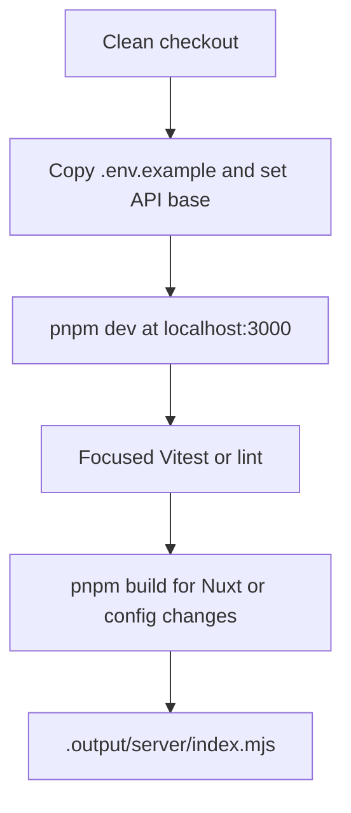

# Repository Quickstart

This repository is a Nuxt 4 storefront. The application source root is `app/` (configured by `srcDir`), while the package root contains the Nuxt, test, and deployment configuration. Start with the shortest path below, then use the routing map before editing a cross-cutting behavior.

## Clean Checkout

Requirements are Node `22.23.4` from `.nvmrc` and pnpm `10.13.0` from `package.json`. With Node installed, enable Corepack so the project can use its declared package-manager version:

```bash
corepack enable
node --version
pnpm --version
pnpm install --frozen-lockfile
```

Copy the example environment file before starting the app:

```bash
cp .env.example .env
```

Set `NUXT_PUBLIC_API_BASE` to the backend endpoint used by the checkout. `/api` is the application fallback and only works when the frontend host or its reverse proxy serves that path. For a directly reachable backend, use its complete API path, for example `https://your-domain.com/api/h5app`. Do not copy real credentials or tokens into `.env`; files matching `.env*` are ignored except `.env.example`, and `NUXT_PUBLIC_*` values are available to both server and browser code.

The other high-impact settings are:

- `NUXT_PUBLIC_BUSINESS_MODE`: `b2c` by default, or `bbc` for BBC-specific storefront behavior.
- `NUXT_PUBLIC_COMPANY_ID`: tenant/company context when the backend requires it.
- `NUXT_PUBLIC_API_TIMEOUT`: request timeout in milliseconds.
- `NUXT_PUBLIC_DECORATION_ADMIN_ORIGINS`: allowed admin origins for decoration preview messaging.
- `NUXT_PUBLIC_AI_ASSISTANT` and the related AI URL/tenant variables: assistant integration switches and endpoints.

## Run And Validate

Start the development server from the directory containing `package.json`:

```bash
pnpm dev
```

Nuxt listens on `http://localhost:3000` and binds to `0.0.0.0:3000`, so the same server is reachable from a container or another host on the network. The app uses SSR by default; the design-mode root route is explicitly client-only.

Use the narrowest validation that proves the change, then run the production build for changes that cross the Nuxt boundary:

```bash
pnpm test        # Vitest: app/**/*.spec.ts and app/**/*.source.test.js
pnpm lint        # ESLint for JavaScript, TypeScript, and Vue files
pnpm build       # Nuxt/Nitro production build
```

`pnpm test` is the repository's configured unit/source-test entrypoint. Focus a run with Vitest's CLI when iterating, for example `pnpm exec vitest run app/utils/currencyFormat.spec.ts`. The Playwright configuration targets Chromium and Mobile Chrome, defaults to `http://localhost:3000`, and can start a dev server, but `package.json` has no Playwright script and the current `e2e-test/` directory is not configured as a test directory. Treat browser checks as an explicit, separately configured activity rather than assuming `pnpm test` runs them.

After changing any `NUXT_*` value used by the generated client bundle, rebuild. Nuxt reads public values into `runtimeConfig.public` during configuration/build; the production artifact does not pick up a changed build-time public API URL until `pnpm build` is run again.



This diagram shows the normal local development and production-artifact path.

## Production Shape

`Dockerfile` installs with `pnpm install --frozen-lockfile`, passes the declared `NUXT_*` build arguments into the builder, runs `pnpm build`, and copies `.output` into a small runner image. The runner starts `node .output/server/index.mjs` on `0.0.0.0:3000`. The PM2 configuration uses the same Nitro entrypoint in cluster mode and expects a reverse proxy in front of `127.0.0.1:3000`.

For a production/configuration change, verify both the environment value and the generated build. A common failure is changing `NUXT_PUBLIC_API_BASE` only in the runtime environment after the client bundle has already been built; another is using `/api` without a proxy route to the backend. See [Configuration, Build, And Deployment Runbook](operations/configuration-and-deployment.md).

## Change Router

Use the first matching route; follow the linked page for control flow, ownership, invariants, and focused tests.

| Change type | Start here | Main ownership |
| --- | --- | --- |
| Runtime/configuration, app boot, routes, stores, composables, or source layout | [System Architecture And Source Map](architecture/system-overview.md) | Nuxt boot/config, `app/`, composables, stores, clients, transformers, and shared types |
| Business mode, locale/country, distributor, money/quantity, or render models | [Runtime Domains And Core Models](concepts/runtime-domains.md) | Stable domain values and cross-page invariants |
| Catalog, product detail, shop context, cart, or local cart recovery | [Catalog, Store Context, And Cart Workflow](workflows/catalog-and-shopping-cart.md) | Product/catalog pages, distributor context, cart store, and cart composables |
| Login, captcha, cookies, profile hydration, refresh, guards, or logout | [Authentication And Session Lifecycle](workflows/authentication-and-session.md) | Auth composables, user/cart stores, plugins, and middleware |
| Checkout totals, address/store selection, order creation, payment, polling, or timeout | [Checkout, Order Creation, And Payment](workflows/checkout-and-payment.md) | Checkout/payment composables, order APIs, and payment pages |
| Orders, invoices, logistics, reviews, aftersales, or account navigation | [Account Orders And Aftersales](workflows/account-orders-and-aftersales.md) | Account pages, order/aftersales composables, and response transformers |
| Decoration DSL, named slots, template fallback, preview, or admin messaging | [Decoration And Template Rendering](architecture/decoration-and-template-rendering.md) | Template engines, decoration engine, SSR data, overlays, and preview protocol |
| API transport, auth headers, global parameters, response/error handling, retry, or transformers | [HTTP Transport And Backend Contracts](integrations/http-and-backend-contract.md) | API clients, Nuxt HTTP plugin, backend boundary, and transformer layer |
| Admin preview iframe or AI assistant iframe/auth/navigation | [Admin Preview And AI Assistant Integrations](integrations/admin-preview-and-ai.md) | Origin checks, `postMessage` payloads, embed URLs, and assistant session contract |
| Environment variables, Docker, Nitro output, PM2, proxy, or deployment failure | [Configuration, Build, And Deployment Runbook](operations/configuration-and-deployment.md) | Build-time/runtime config and `.output` operations |
| Unit/source tests, browser tests, fixtures, or regression coverage | [Testing And Change Validation](testing/validation-guide.md) | Vitest configuration, source tests, Playwright configuration, and domain suites |

## Useful Boundaries

Nuxt configuration is at `nuxt.config.ts`; scripts and versions are authoritative in `package.json`; the checked-in lockfile is `pnpm-lock.yaml`; and the public environment contract is documented by `.env.example`. Keep changes near the owning boundary and add or update a focused test beside the affected source when the behavior is covered by Vitest.

For a broader map of the application lifecycle and source relationships, continue to [System Architecture And Source Map](architecture/system-overview.md).
