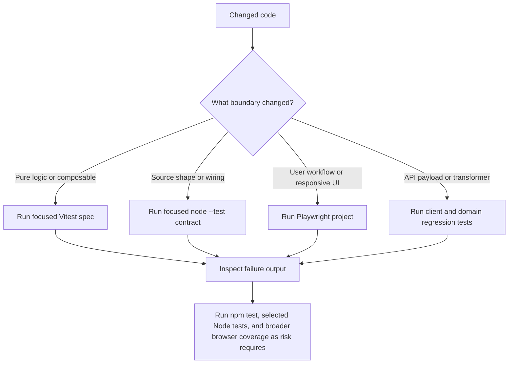

# Testing And Change Validation

Validation in this repository is layered. Small pure helpers and composables are best covered by Vitest; source-structure tests protect wiring and generated/runtime assumptions; browser tests are intended for user-visible workflows; and domain regression suites protect contracts that cross pages, stores, API clients, transformers, and external integrations.



*The intended validation path routes a change to the narrowest suite that exercises its real boundary before broader checks.*

## Test discovery and commands

The package scripts define `npm test` as `vitest run`. `vitest.config.ts` explicitly includes only:

```text
app/**/*.spec.ts
app/**/*.source.test.js
```

That means TypeScript `*.spec.ts` files and JavaScript files named `*.source.test.js` are discovered by the default Vitest run. Ordinary `*.test.js` files, including `app/pages/checkout/checkout-payment.behavior.test.js`, `app/pages/account/orders/aftersales-submit-payload.test.js`, and `app/pages/build/business-mode-bbc-regression.test.js`, are not included by that pattern even though they are important tests. Run those files explicitly with Node's built-in test runner:

```bash
npm test
node --test app/pages/checkout/checkout-payment.behavior.test.js
node --test app/pages/account/orders/aftersales-submit-payload.test.js
node --test app/pages/build/business-mode-bbc-regression.test.js
```

For a focused Vitest run, pass a file or a narrow pattern after `npm test`, for example:

```bash
npm test -- app/composables/usePayment.spec.ts
npm test -- app/infrastructure/http/clients/PaymentApiClient.spec.ts
npm test -- app/utils/aiAssistantEmbed.spec.ts
```

Run the complete set of repository source-structure tests explicitly when a broad wiring change warrants it:

```bash
node --test 'app/**/*.test.js'
```

Shell glob behavior differs by shell, so use explicit paths or a shell that expands the glob when needed. Always retain the complete command output, including failing test names, assertion messages, stack traces, and the first relevant source location. A summary such as “tests failed” is not enough to diagnose a contract regression.

## Vitest unit and runtime behavior tests

Vitest tests execute code with mocks, timers, and controlled browser globals. They are the primary focused check for runtime behavior that can be isolated without mounting the whole Nuxt application.

`usePayment.spec.ts` exercises the external `doumen_intl` payment lifecycle: payment opens the returned URL in a new tab, leaves the current page waiting, polls order status every five seconds, becomes `unconfirmed` after the 60-second timeout rather than `fail`, and can become successful after a manual recheck. Fake timers and mocked `paymentApiClient` calls make timeout and polling behavior deterministic.

`PaymentApiClient.spec.ts` protects the HTTP boundary for offline transfer. It checks that `voucher_pic` is expanded into indexed form keys such as `voucher_pic[0]` and that `uploadOfflineVoucher` posts to `/wxapp/order/offline/upload/voucher` with the expected method and body. Treat these assertions as backend contract tests, not merely helper tests: changing field names, encoding, or endpoint handling can break the server integration while leaving local types apparently valid.

`aiAssistantEmbed.spec.ts` covers integration-facing URL and message construction. It checks explicit enablement values, URL normalization and fallback selection, mobile user-agent classification, distributor-id precedence, the `ECSHOPX_AUTH` payload shape, query parameter names, popup behavior, and `postMessage` target-origin handling. Changes to AI configuration, authentication context, route parsing, or iframe security should start here.

Other focused Vitest targets include `app/composables/useCurrency.test.ts`, the decoration utility specs, infrastructure transformer specs, and utility tests under `app/utils`. Prefer a single target first, then related targets, then the full `npm test` run.

## Source-structure tests versus runtime behavior tests

Source-structure tests are deliberately separate from runtime behavior tests. They read source files with `readFileSync` and assert the presence or absence of imports, endpoints, selectors, branch conditions, component registrations, or ordering. They are fast and useful for protecting contracts that are difficult to exercise without backend data, but they do not prove that Vue renders correctly or that a request succeeds.

Examples include:

- `app/decoration-engine/components/decoration-core.test.js` checks the decoration DSL types, message names, origin-aware preview message handling, registry provision, ordered/disabled section rendering, highlight scrolling, and the existence of registered section components.
- `app/pages/account/orders/aftersales-submit-payload.test.js` checks the aftersales API form body, indexed detail item fields, local image upload path, selected-item mapping, and preservation of the order row identifier through the transformer and order pages.
- `app/pages/build/business-mode-bbc-regression.test.js` checks that Nuxt runtime configuration and UI gates agree on `bbc` rather than the legacy `b2b` spelling.
- `app/pages/build/nuxt-config-env-log.test.js` checks that build diagnostics filter and print only `NUXT_` environment entries.
- `app/pages/checkout/checkout-payment.behavior.test.js` checks checkout's payment-method preflight, `doumen_intl` current-tab redirect, order creation handoff, and `router.replace` navigation.
- `app/stores/user-login-cart-refresh.test.js` checks the cross-store ordering invariant: `completeLogin` loads user information before silently refreshing the cart.

When changing source text, names, imports, endpoint strings, page metadata, or cross-file wiring, run the matching Node test explicitly. When changing actual control flow, state transitions, rendering, or request behavior, pair the source test with a Vitest or browser test; a regex match cannot detect a runtime exception or an incorrect DOM result.

## Playwright browser coverage

`playwright.config.ts` currently defines two active projects:

- `chromium`, using `devices['Desktop Chrome']`.
- `Mobile Chrome`, using `devices['Pixel 5']`.

Firefox, WebKit, and Mobile Safari configurations are present but commented out. The shared `baseURL` is `BASE_URL` when set, otherwise `http://localhost:3000`. The configured `webServer` runs `npm run dev`, waits for `http://localhost:3000`, and reuses an existing server. CI forbids accidental `test.only`, retries failures twice, and uses one worker; locally there are no retries by default. The HTML reporter is enabled and traces are collected on the first retry.

The repository includes `e2e-test/test-cart.md`, a manual cart test inventory rather than an executable Playwright spec. It covers P0/P1/P2 scenarios such as adding items, quantity changes and deletion, stock limits, unavailable products, selection, batch deletion, subtotal/total calculations, and cross-device synchronization. Because this file is Markdown and no Playwright test files are currently registered by the configuration, treat it as acceptance coverage to implement or execute manually until executable specs exist.

Use the browser layer for changes involving navigation, responsive layout, checkout and payment-page interaction, cart controls, authentication flows, iframe/popup behavior, or DOM contracts that unit tests cannot establish. Start the server through Playwright's `webServer` configuration or run `npm run dev` separately when performing manual checks. Record the project (`chromium` or `Mobile Chrome`), `BASE_URL`, test data/auth state, and any trace or HTML report when reporting failures.

## Risk-to-suite map

Use the smallest relevant set first:

| Change area | First validation | Follow-up validation |
| --- | --- | --- |
| Payment composable timing, result state, redirect, or platform selection | `npm test -- app/composables/usePayment.spec.ts`; `node --test app/composables/usePayment.behavior.test.js` | Payment page browser flow on desktop and mobile; then `npm test` |
| Payment API endpoint, request body, offline voucher encoding, or payment-list query | `npm test -- app/infrastructure/http/clients/PaymentApiClient.spec.ts`; related payment behavior Node test | Checkout/payment browser flow and backend contract verification |
| Checkout payment-method preflight or route handoff | `node --test app/pages/checkout/checkout-payment.behavior.test.js` | Playwright checkout flow in both active projects |
| Decoration DSL, registry, iframe messages, focus/highlight, or section ordering | `node --test app/decoration-engine/components/decoration-core.test.js` plus focused decoration specs | Browser preview/editor flow, including origin and responsive behavior |
| Aftersales payload, transformer, or upload integration | `node --test app/pages/account/orders/aftersales-submit-payload.test.js` plus related account/aftersales tests | Authenticated order browser flow and API verification |
| Login, cart refresh, cart persistence, or logout | `node --test app/stores/user-login-cart-refresh.test.js` plus cart/store tests | Cart acceptance scenarios from `e2e-test/test-cart.md` in desktop and mobile projects |
| Business mode, Nuxt config, or environment diagnostics | `node --test app/pages/build/business-mode-bbc-regression.test.js app/pages/build/nuxt-config-env-log.test.js` | `npm run build` with representative `NUXT_` variables; inspect build output |
| AI assistant enablement, URL/auth payload, popup, or iframe messaging | `npm test -- app/utils/aiAssistantEmbed.spec.ts`; relevant `*.source.test.js` | Browser popup/iframe flow with configured AI URLs and explicit origin checks |

After focused validation passes, run `npm test` for the complete Vitest-discovered set. Add all relevant explicitly-run Node tests for changed domains. Run `npm run lint` for JavaScript, TypeScript, or Vue changes and `npm run build` when Nuxt configuration, environment handling, route generation, plugins, or deployment-facing code changes.

## Cross-system contracts and failure interpretation

Several regressions are only visible across layers:

- Payment page and `PaymentApiClient` must agree on response fallbacks (`data`, `payment`, `pay_url`, and redirect fields), payment execution type, and offline voucher form encoding. A passing helper test does not establish that checkout creates the right order or that the browser navigates correctly.
- Aftersales selection, order transformers, account list/detail pages, and `AftersalesApiClient` must preserve the order-item row id and serialize every selected detail item. Validate the full path when changing item models or payload construction.
- Decoration preview depends on a message protocol shared by DSL types, the preview composable, the renderer, and the registry. Validate both structural message names/origin checks and the browser/editor interaction when changing protocol fields or section registration.
- Login owns profile loading before cart refresh. Changes to either store should preserve that ordering and test the resulting cart state, not just the existence of both calls.
- Nuxt environment diagnostics and business-mode gates are source/configuration contracts. Run the explicit Node tests and a representative build because regex tests do not evaluate the generated Nuxt runtime.

When a test fails, preserve its raw failure output and classify the failure before changing code: discovery/configuration failure, source-contract mismatch, runtime assertion, browser/environment setup, backend fixture/data, or a genuine product regression. Include the exact command and project/configuration used. Do not suppress a failure by renaming a test so it falls outside Vitest discovery or by weakening a source assertion without checking the corresponding runtime and integration contract.

## Fixtures and environment assumptions

Use Node `22.23.4` and pnpm `10.13.0` as declared in `package.json`; install dependencies before running tests. Vitest aliases `#imports` to `vitest.nuxt-imports.mock.ts`, and tests commonly stub `useNuxtApp`, `useI18n`, `window`, `navigator`, timers, and HTTP clients. Keep those mocks aligned with the actual Nuxt/plugin boundary when adding tests.

Playwright assumes a reachable local Nuxt dev server and uses `BASE_URL` for a non-default target. Checkout, account, payment, cart, and AI assistant browser coverage may additionally require authenticated users, API fixtures, configured public runtime values, product/order data, popup permissions, and reachable external services. Document those prerequisites in the test or run report. A green source-structure test is not evidence that these external fixtures are available.
