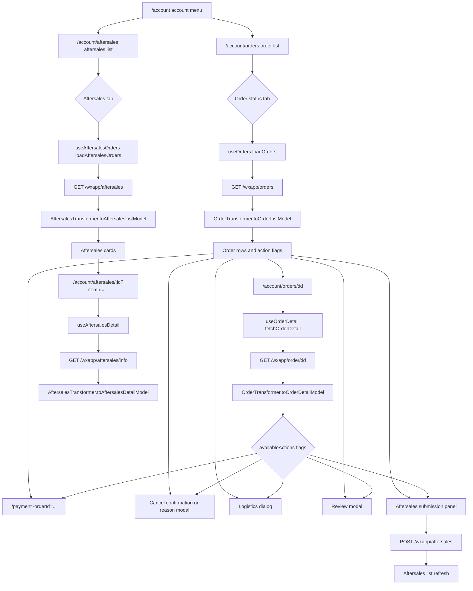

# Account Orders And Aftersales

## Scope And Entry Points

The account area exposes the profile landing page at `/account`, the order list at `/account/orders`, an order detail route at `/account/orders/:id`, the aftersales list at `/account/aftersales`, and an aftersales detail route at `/account/aftersales/:id`. The account menu and mobile filter menu make orders and aftersales sibling destinations. The profile page itself loads account summary data, but order and aftersales data are owned by their dedicated composables and pages.

The list pages are responsible for route-level rendering, tabs, pagination, loading and empty states, and opening dialogs or navigating to details. The composables own request state and mutations. `OrderApiClient` and `AftersalesApiClient` own endpoint paths and request-specific serialization, while the transformer layer converts unwrapped API payloads into stable view models. The clients deliberately return raw responses and do not perform model conversion.



*This flowchart shows how account navigation feeds list filters, order actions, and the separate aftersales list/detail lifecycle.*

## Order List Lifecycle

`useOrders` initializes with status `ALL`, page `1`, page size `10`, and empty request state. `loadOrders` sets `loading`, clears the previous error, calls `orderApiClient.getOrderList`, transforms the response, and adds localized status text. A first page replaces the list; later pages append to it. `total` comes from the transformed pager data, and `hasMore` is computed as `currentPage * pageSize < total`. The page uses `ECPagination`, which calls `loadOrders(currentStatus, page)`; it does not use the older mobile load-more interaction.

The UI status tabs are application-level `OrderStatus` values, but the composable translates only the backend-supported list filters: `ALL` to `0`, pending payment to `5`, shipped or pending receipt to `1`, pending pickup to `4`, and pending review to `3`. The aftersales tab uses the string `AFTER_SALES` in this order-list request and is marked in code as a separate or assumed backend marker; the dedicated aftersales page is the authoritative list for aftersales records. Changing a status reloads page 1, while refresh preserves the current status and resets to page 1.

Status text has two list-level overrides. An offline payment with `offlinePayCheckStatus` `0` is displayed as awaiting merchant confirmation, and a partial delivery is displayed with its partial-delivery label before the normal status mapping. This is presentation logic applied after transformation, so raw status and action flags remain available to the page.

The page renders skeletons before the first completed request, an empty state only after a completed request with no rows, and toast-backed error state from the composable. Each row navigates to `/account/orders/:orderId`; action button clicks stop propagation so they do not also navigate to the detail route.

## Order Status And Action Rules

`OrderTransformer.toOrderModel` is the main action-policy boundary. It combines payment, cancellation, delivery, offline voucher, and item-level aftersales fields into normalized status and capability flags:

- `pending_payment` is derived from an unpaid order, unless the order is cancelled. `pending_shipment`, `shipped`, and `completed` are derived from delivery status; partial delivery remains a pending-shipment order but is separately marked `isPartialDelivery`.
- Cancellation is available for unpaid, pending-shipment, or shipped orders except partial deliveries and offline vouchers awaiting review. Paid orders require a reason workflow; unpaid orders use a confirmation dialog.
- Payment is available for pending payment unless an offline voucher is awaiting merchant review. A rejected offline voucher exposes `change_offline`, which navigates to `/payment` with `has_check=true`.
- Confirmation of receipt is limited to shipped, non-partial orders. Logistics is available for partial, shipped, or completed orders. After-sales requires item-level remaining quota and either partial, shipped, or completed delivery. Review is available only for `pending_review`.
- The order list chooses a primary mobile action in priority order: pay, change offline voucher, confirm receipt, then review. Secondary actions include cancellation, aftersales, logistics, and deletion, with overflow actions placed in a mobile popover. Desktop renders the full set of enabled actions.

The detail page consumes the same capability flags through `useOrderDetail.availableActions`. It fetches `/wxapp/order/:id`, accepts either the raw payload or an `orderInfo` wrapper, transforms it, then resolves status text and translates generated shipping/invoice keys. A failed fetch leaves `order` empty, shows the error and retry control, and keeps the API error in the composable state.

## Order Actions And Detail Features

Cancellation is centralized in `useOrderCancel`. `requestCancel` determines whether the order is paid, stores the target and post-success callback, and either opens the paid-order reason modal or asks for confirmation for an unpaid order. `submitCancel` builds the payload with `buildCancelOrderPayload`, calls `POST /wxapp/order/cancel`, closes the reason modal on success, and refreshes the originating list or detail. A cancelled request returns `false` and displays an error except for the validation sentinel `other_reason_required`.

Payment uses `useOrders.buildPaymentPath` or the equivalent detail implementation. It always includes `orderId`, adds `distributor_id` only when it is not `0`, and adds `has_check=true` for a rejected offline voucher. The detail page also exposes payment as `/payment` navigation rather than making a payment API call itself.

Receipt confirmation and deletion both require a modal confirmation, call `OrderApiClient.confirmReceipt` or `deleteOrder`, show a success or failure toast, and refresh the current data after success. The list composable also contains a `buyAgain` placeholder that currently only shows a toast, so it is not an implemented repeat-purchase workflow.

Logistics is deliberately tolerant of backend failure. The list composable requests order detail and `/wxapp/trackerpull` in parallel; a successful detail response supplies tracking metadata and fallback traces, while tracker traces take precedence when present. The detail composable requests tracker data with common error codes suppressed from global transport toasts, maps `AcceptTime` and `AcceptStation` through `toTrackerPullTraces`, and falls back to traces embedded in the order detail. A logistics error is surfaced only when no fallback traces exist, and the dialog offers retry.

The order detail page renders receiver, shipping, invoice, payment, and amount information from the detail model. Invoice submission is delegated to `useInvoiceForm`; after a successful submit, the detail composable updates `invoiceInfo` with the formatted invoice summary. Review opens a modal for the first order item and reloads the detail after submission. The list page follows the same first-item convention and reloads the current page after a review.

## Aftersales Submission From An Order

The order list and detail pages open `AftersalesPanel` only when the transformed order says `canApplyAftersales`. Opening the panel first loads aftersales reason options and, from the list page, fetches fresh order detail so the selectable item rows reflect current quotas. The panel receives each item's `detailId`, `itemId`, quantity, delivery state, remaining aftersales quantities, price, and display fields.

The panel resets on open. It starts with no selected items, chooses `ONLY_REFUND` for an incompletely shipped order and `REFUND_GOODS` otherwise, clamps quantities to the item/type-specific maximum, and clears selections when the aftersales type changes. A submission requires at least one selectable item and a reason, and refuses to submit while evidence images are uploading.

Evidence files are restricted to images and at most three files. Each file is uploaded through `AftersalesApiClient.uploadLocalImage`, which delegates to `uploadApiClient.uploadImage` and normalizes the result to `{ data: { image_url, url } }`. Failed uploads remove the preview and show a toast. The final request uses `AftersalesApiClient.submitAftersales`, which posts `/wxapp/aftersales` as a form-shaped body:

- `order_id`, `reason`, `aftersales_type`, `description`, `evidence_pic`, and `freight` are scalar fields. Evidence URLs are joined with commas and freight is `0`.
- Every selected row becomes `detail[0][id]`, `detail[0][num]`, and so on. The `id` is the order detail row identifier, not merely the product identifier.
- `REFUND_GOODS` adds `return_type: 'logistics'`; the client defaults this field to logistics if the caller does not provide it.

A successful submit emits `submitted` and closes and resets the panel; the order list or detail then reloads its data. This preserves the cross-layer invariant that the item row id survives transformer mapping, page mapping, selection, and indexed API serialization.

## Aftersales List And Detail

`useAftersalesOrders` owns the aftersales list with page size `10`, current tab, current page, total, loading, empty, and error state. Its tab map is exact: `all` omits `aftersales_status`, while `pending`, `processing`, `processed`, `rejected`, and `closed` send `0`, `1`, `2`, `3`, and `4`. `AftersalesApiClient.getAftersalesList` always sends `order_type: 'normal'` and calls `GET /wxapp/aftersales`. The page uses `ECPagination`; status changes reload page 1 and page changes preserve the selected status. Cancelling an aftersales record calls `/wxapp/aftersales/close` and refreshes the current list on success.

`AftersalesTransformer.toAftersalesListModel` accepts either a response data wrapper or direct payload, reads `list`, and obtains the total from `total_count`. It normalizes numeric and textual backend statuses into the five tab buckets, resolves store-name fallbacks, maps detail/item records through `OrderTransformer.toOrderItemModel`, and preserves refund amounts as live API values rather than applying the order transformer's cents conversion.

The aftersales detail route requires both a route `id` and query `itemId`. `useAftersalesDetail` sends them as `aftersales_bn` and `item_id` to `GET /wxapp/aftersales/info`; missing identifiers are treated as an error before a request. The transformer combines `app_info.order_info` or `order_info` with `refund_info`, derives three progress steps from the record's progress, maps receiver, reason, description, evidence, payment, timestamps, and amount sections, and uses the detail lines to retain order item identifiers. The page prefers backend `actionButtons`, but supplies a cancel action for pending records when the backend returns none. Cancel reloads the detail after calling `/wxapp/aftersales/close`.

One implementation detail matters when changing this boundary: `cancelAftersales` accepts an `itemId` in the composable and callers pass one from the first item, but the current HTTP client sends only `aftersales_bn` in the close request query. Do not assume the item id is currently part of the wire contract without changing and testing `AftersalesApiClient`.

## Focused Validation

These workflows have source-structure tests because several important contracts cross Vue pages and endpoint clients:

```bash
node --test app/pages/account/orders/orders-pagination.test.js
node --test app/pages/account/orders/aftersales-submit-payload.test.js
node --test app/pages/account/aftersales/aftersales-api-alignment.test.js
node --test app/pages/account/aftersales/aftersales-detail-transformer.test.js
```

`orders-pagination.test.js` protects `page` and `pageSize` query names, pager extraction, and the page's use of `ECPagination`. `aftersales-submit-payload.test.js` protects indexed detail fields, default return type, local image upload wiring, selected item mapping, and row-id preservation. The aftersales alignment tests protect numeric status mappings, normal order type, live identifiers, store fallbacks, refund amount units, and detail sections. These are source-contract tests, so changes to actual runtime control flow should be paired with focused Vitest or authenticated browser coverage as described in the validation guide.

The broader transport boundary is documented in [HTTP Transport And Backend Contracts](/openwiki/integrations/http-and-backend-contract.md), and the test-discovery caveat is documented in [Testing And Change Validation](/openwiki/testing/validation-guide.md): these `*.test.js` files are not part of the default Vitest include pattern and must be run explicitly with Node.
