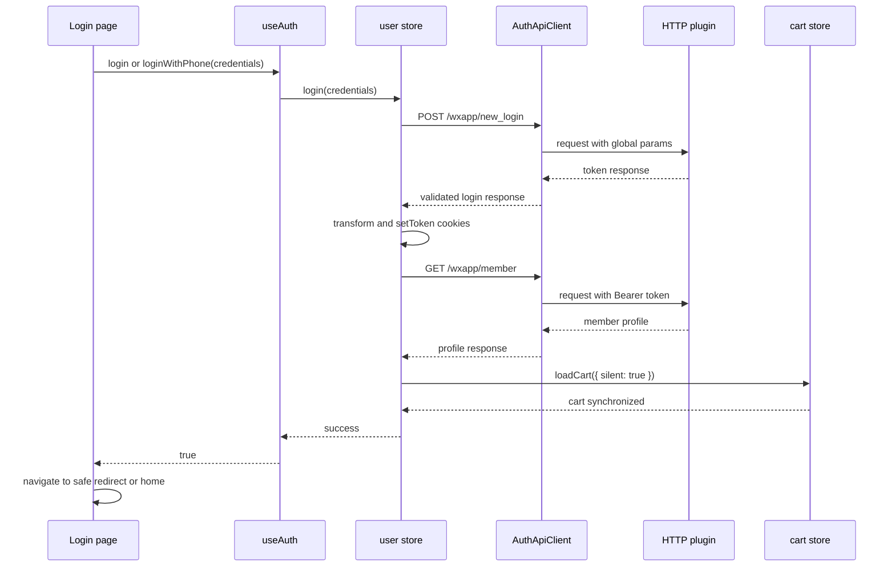
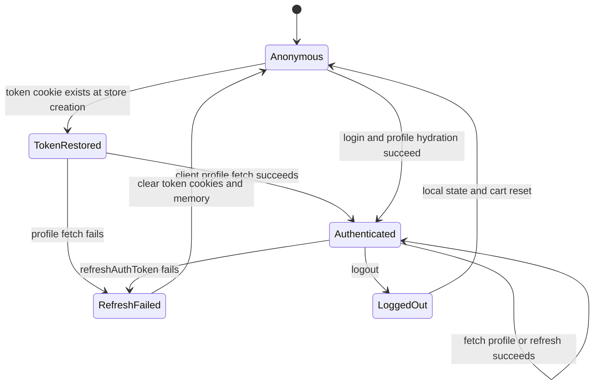

# Authentication And Session Lifecycle

This workflow has three distinct layers: `AuthApiClient` performs the authentication HTTP calls, `AuthTransformer` validates and shapes API responses, and the `useUserStore` Pinia store owns the in-memory session state and token-cookie synchronization. `useAuth` is the UI-facing facade that manages loading, errors, captcha state, and delegates login/logout/profile operations to the store.

## Entry Points And Ownership

- `app/pages/account/login.vue` validates phone or email credentials, calls `useAuth().loginWithPhone()` or `useAuth().login()`, and navigates to the validated `redirect` query value after success. The redirect must be an absolute-path URL beginning with `/` but not `//`; otherwise login falls back to the localized home route.
- `app/pages/account/register.vue` is a verification-first registration flow. It obtains a member captcha through `useAuth`, sends the SMS code through `useSmsCode`, validates password agreement and terms acceptance, then calls `AuthApiClient.registerMember()` or `registerEmailMember()`. Registration does not complete a session: success displays a message and navigates to `/account/login` after 1.5 seconds.
- `app/composables/useAuth.ts` exposes `getCaptcha`, `refreshCaptcha`, both login modes, `logout`, `fetchUserInfo`, and `initUserState`. It converts store results into booleans and localized UI errors; it does not persist tokens itself.
- `app/stores/user.ts` is the session authority. Its state contains `isLoggedIn`, `token`, `refreshToken`, and in-memory `userInfo`; its state initializer reads `token` and `refreshToken` cookies once when the store is created.
- `app/plugins/auth-init.ts` depends on the `http` plugin. On the client, a restored token triggers `fetchUserInfo`; the same plugin starts cart loading independently. Profile hydration is client-only to avoid SSR rendering a partial profile.

## Login And Hydration

The login page performs local format/required-field validation. Email credentials are sent as `username`; phone credentials are sent as `phone`, which the store/client maps to the API `username` field. Both paths call `POST /wxapp/new_login` with the API's local-password parameters. The HTTP plugin injects global request parameters such as `company_id`, `country_code`, and applicable distributor context, and adds `Authorization: Bearer <store token>` when a token is already present.

`AuthApiClient` rejects a new-login response when `status === 0` or when `token` is absent. `AuthTransformer.toLoginModel()` additionally requires a token and produces an application model with a default `expiresIn` of 7200 seconds and an empty `refreshToken`. The store then:

1. Clears any old in-memory profile.
2. Writes the token and refresh token to Pinia and cookies using `setToken()`.
3. Fetches `/wxapp/member` and transforms `memberInfo`; a missing `memberInfo` or `user_id` is invalid.
4. On successful profile hydration, reloads the cart with `{ silent: true }`, so the mounted header sees the authenticated cart count.
5. Returns success to `useAuth`, after which the page navigates to the safe redirect or home.

The auth cookies and Pinia state have different lifetimes and roles. `token` is persisted for seven days and `refreshToken` for 30 days by `setToken`; `userInfo` is never persisted by this store and must be hydrated again after a reload. A token cookie therefore means “a session may be restorable,” while `userInfo` is only available after a successful profile request.

This sequence shows the successful credential login path through profile hydration and cart refresh.

## Captcha And Registration

Captcha requests are not cached. `AuthApiClient.getCaptcha()` selects `/wxapp/distributor/image/code` by default or `/wxapp/member/image/code` for registration, and `AuthTransformer.toCaptchaModel()` requires both `imageData` and `imageToken`, assigning a five-minute default lifetime. Registration uses the member endpoint and the image token as the verification token. A failed registration refreshes the captcha; an image-captcha error while sending SMS also refreshes it.

The registration API calls are separate from login: phone registration posts to `/wxapp/member` with `mobile`, `password`, and `vcode`; email registration posts to `/wxapp/member/email/register` with `email`, password confirmation, captcha token, and captcha answer. Neither method calls `completeLogin` or writes auth state.

## Startup Restoration And Refresh

The store constructor initializes `isLoggedIn` from the `token` cookie, not from `userInfo`. The `auth-init` plugin then calls `fetchUserInfo()` only when a token exists and only on the client. `fetchUserInfo()` deduplicates concurrent calls through a module-level promise, calls `GET /wxapp/member`, and replaces the profile with the transformed model.

Any profile-fetch failure is treated as token invalidation: the store clears `isLoggedIn`, `userInfo`, both token values, and both cookies. `initUserState()` is retained as a compatibility wrapper around this profile fetch and also clears tokens if its call throws.

`refreshAuthToken()` exists on the store and calls `POST /wxapp/auth/refresh` when `refreshToken` is present. It transforms the response and writes the new token pair. Any missing refresh token or refresh failure clears the same session state and cookies. In the current implementation, `AuthTransformer.toLoginModel()` always emits an empty refresh token, while the HTTP response hook writes a header refresh token to the cookie named `refresh-token` and the store reads `refreshToken`; refresh-token rotation should therefore be treated as an integration constraint requiring verification before relying on it operationally.

This state model separates cookie restoration from authenticated profile availability and shows that all invalidation paths converge on cleared local credentials.

## Protected Routes

`app/middleware/auth.global.ts` is a global route middleware. It strips the locale prefix, then checks whether the normalized path starts with one of the actual protected prefixes:

- `/member`
- `/cart`
- `/order`
- `/account/profile`
- `/account/sign-in`

For a protected path, the middleware reads `useUserStore().isLoggedIn`. If false, it redirects to the localized `/account/login` route and carries the attempted `to.fullPath` as `query.redirect`. It does not itself fetch a profile or restore cookies, so middleware correctness depends on the store's cookie-derived token state and on startup hydration having completed where applicable. Paths outside this list are not guarded by this middleware.

The HTTP plugin provides a second failure boundary. A transport 401 or business 401 navigates the client to the localized login page; other HTTP/business failures are normalized, optionally toasted, and rethrown. This is complementary to the route middleware: middleware prevents entry based on local state, while the HTTP layer handles an expired or rejected credential during a request.

## Logout And Cart Semantics

`useAuth().logout()` delegates to `userStore.logout()`. Logout is local and synchronous in its effects: it marks the store logged out, clears `userInfo`, clears both token cookies, and calls `cartStore.resetLocalCart()`. There is no logout request in `AuthApiClient` and no server logout endpoint call.

`resetLocalCart()` clears items, store groups, invalid items, totals, discount, initialization state, cart UI state, and the client-side `cart_cache` from `localStorage`. It deliberately does not call `cartApiClient.clearCart()`, so logout removes the local view and cache without deleting the server-side cart. A later authenticated startup or login can load the server cart again.

## Invariants And Failure Handling

- A successful login is not complete until profile hydration succeeds. `completeLogin()` returns the profile failure instead of synchronizing the cart when `/wxapp/member` fails.
- A token without a valid profile is not retained after a failed profile request; token cookies and in-memory profile state are cleared.
- Logout never leaves a stale local cart cache or authenticated Pinia state behind.
- Login and profile failures are returned as `{ success: false, error }` by the store and converted to UI errors by `useAuth`; loading flags are reset in `finally` blocks.
- Captcha models are rejected when either image data or token is missing, preventing registration from sending an incomplete verification request.
- Profile fetches are deduplicated while one request is in flight, preventing parallel startup callers from racing updates.

## Focused Tests And Safe Changes

The most relevant regression checks are the source-level tests under `app/stores/`:

- `user-login-cart-refresh.test.js` verifies profile hydration occurs before silent cart reload in `completeLogin()`.
- `user-logout-local.test.js` verifies logout clears local tokens and invokes `resetLocalCart()` without an auth logout API.
- `cart-logout-local.test.js` verifies local cart fields and `cart_cache` are cleared without calling the server cart-clear operation.
- `app/pages/account/sign-in-page-structure.test.js` verifies `/account/sign-in` remains in the protected route list.

When changing authentication, preserve the ordering of token write, profile hydration, and cart synchronization; test both cookie persistence and in-memory state separately. When changing refresh handling, test the cookie names and response-header contract end to end, because the current store, transformer, and HTTP hook use different refresh-token conventions.
