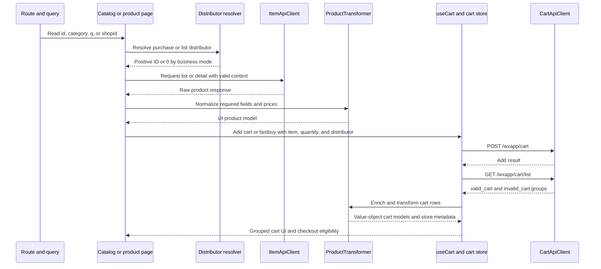
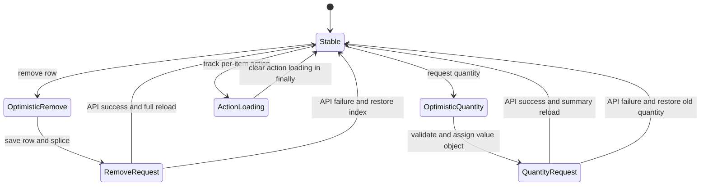

# Catalog, Store Context, And Cart Workflow

The catalog and cart path has three boundaries:

1. **Route and business context** selects category, search, and optional `shopid` context. B2C requests may resolve a default distributor; BBC requests must not inherit the B2C default store.
2. **HTTP clients and transformers** keep wire payloads separate from application models. Product lists/details become UI products; cart rows become models containing `MoneyValueObject` and `QuantityValueObject` instances.
3. **Pinia cart state and `useCart`** own cart lifecycle, store grouping, purchase rules, UI projection, cache persistence, and optimistic mutations.

## Catalog and store entrypoints

### Home and shop routes

`app/pages/shop/[id].vue` treats the route parameter as the shop/distributor ID and reads `route.query.q` as the search keyword. `useHomeData` loads the home template configuration and the first 20 products in parallel. The product request includes `distributor_id` when a shop ID is present and uses an SSR cache key of `home-data-${distributorId}` or `home-data`.

This route currently supplies shop presentation data locally, while product data comes through `useProduct`. A query `q` change triggers another home fetch. `useProduct.loadProducts` calls `ItemApiClient.getItemList`, converts `data.list` with `ProductTransformer.toModelList`, and replaces the list, total, and brands. A list failure clears products and returns `{ success: false, error }` rather than throwing to the page.

### Collection/list routes

`app/pages/collections/[id].vue` uses the route parameter and query values to build a list request. Category semantics are preserved at the API boundary: management categories use `main_category`, while sales categories use `category_id`. Search uses `keywords`; brand, sort, and price filters are forwarded when present. Pagination appends transformed products rather than replacing the existing list.

The query `shopid` has two related but distinct effects:

- It is displayed as BBC shop header context when present.
- It is used as a distributor request parameter only when `getBusinessMode() === 'b2c'`; the value is normalized through `resolveDistributorId`.

A valid positive route ID wins. In B2C, a missing or invalid ID falls back to the default distributor store. In BBC, the fallback is `'0'`, and the list page deliberately omits `distributor_id`, because a B2C store ID can produce incorrect BBC price or inventory data. `ItemApiClient` also strips non-positive distributor IDs from the actual list and detail request query.

### Product detail and purchase context

`app/pages/products/[id].vue` reads `shopid` from the query for shop presentation and purchase context. Product detail requests are made through `ItemApiClient.getItemDetail`; `useProduct.loadProduct` or its SSR variant transforms the result with `ProductTransformer`. Detail price and stock/specification values can be selected from the matching SKU, so add-to-cart is based on the currently selected specification.

For both normal add-to-cart and fast buy, the purchase distributor is resolved in this order:

1. route `shopid`;
2. the product payload's `distributor_id`;
3. `resolveDistributorId`, which applies the B2C default-store rule and BBC no-fallback rule.

Normal add-to-cart uses `cart_type: 'cart'`. Fast buy uses `cart_type: 'fastbuy'`, and after a successful add it navigates to `/checkout?mode=fastbuy`; a positive purchase distributor is also carried as `shopid` so freight and order calculation use the same store context. The PDP source test protects this propagation.

*This sequence shows how route/shop context reaches product requests and then the cart load after an add or fast-buy operation.*

## Product transformation boundary

`ItemApiClient` is deliberately network-only and lazily obtains Nuxt's `$api`, which keeps construction SSR-safe. It does not transform payloads. `ProductTransformer` performs the application-facing normalization:

- `item_id`, a name (`itemName` or `item_name`), and a numeric price are required for a valid product;
- `pics` accepts an array, JSON-encoded array, or a single non-JSON string and becomes a string array;
- absent activity, market, member, and sales values default to zero;
- `toModelList` drops invalid products instead of producing placeholder products;
- `toModel` itself returns an empty fallback model for one invalid input, so callers that need filtering should use `toModelList` or `validateProductList`.

The transformer maps API values to the card/detail shape; price arithmetic and display remain with value objects and the consuming components. Product list loading replaces state, while `loadMore` appends. Detail loading clears the current product on a missing or failed response.

## Cart load and model lifecycle

The cart API is cross-store by design. `CartApiClient.getCartList()` calls `/wxapp/cart/list` with `skipDistributorId: true`, so the cart request is not accidentally narrowed to the current catalog store. Mutation endpoints are separate: add uses `POST /wxapp/cart`, quantity uses `PUT /wxapp/cartupdate/num`, remove uses `DELETE /wxapp/cartdel`, and selection updates use the check-status endpoints.

`useCartStore.loadCart()` reads the response's `valid_cart` and `invalid_cart` groups:

1. Each group's `list` is flattened.
2. `CartTransformer.enrichItemWithGroup` fills missing row store fields from group metadata, including `shop_id`, distributor ID, store name, and logo.
3. Valid rows become `items`; invalid rows become `invalidItems`.
4. `valid_cart` order becomes `storeGroups` through `toStoreGroupMeta`.
5. The first valid group supplies `cart_total_price` and `discount_fee`, both stored as cents.
6. A complete load marks the cart initialized, updates UI last-update time, and writes the cache.

The cart transformer converts wire cents to major currency units before constructing `MoneyValueObject`. Effective unit price follows the mobile-compatible priority `activity_price > package_price > member_price > price`. Quantity is constructed as `QuantityValueObject.of(apiItem.num || 1, 1, apiItem.store || 0)`, so the model's quantity cannot be below one or above stock. A zero-stock row can therefore fail value-object construction when its fallback quantity is one; stock-bearing API data must be valid before it reaches the model boundary.

### Valid versus invalid cart content

`valid_cart` and `invalid_cart` are server classifications, not interchangeable UI lists. Valid rows participate in totals, selection, store grouping, and checkout. Invalid rows remain visible in a separate invalid-items section and can be removed, but they are not checkout candidates.

At the raw-data utility boundary, `CartTransformer.validateCartItem` requires `cart_id`, `item_id`, `item_name`, a string or numeric `price`, numeric `num`, and numeric `store`. `validateCartList` filters to those rows. `sanitizeCartItem` instead supplies defaults for missing fields. The normal cart load path uses group enrichment and `toModelList` directly, so malformed or inconsistent server data can still fail later at value-object construction; validation/sanitization helpers are available for callers that need an explicit raw-data gate.

`useCart` defines purchasability as `stock > 0` and `quantity.value <= stock`. `canCheckout` requires at least one selected item and every selected item to be purchasable. `isAllSelected` considers only purchasable valid items. In BBC, `validateCheckoutSelection` additionally rejects selected items spanning multiple distributor/store IDs; B2C permits multi-store selection subject to the ordinary purchasability rules.

### Store grouping

The cart UI groups transformed valid rows using `cartStore.storeGroups`, whose order comes from `valid_cart`. A row's store ID is normalized from `distributor_id`, `shop_id`, `store_id`, nested distributor/shop metadata, or an empty value. Empty row IDs are matched as `'0'`. Groups without rows are omitted. Rows not assigned to a declared group are retained in an `orphan` group rather than silently discarded. If no group metadata exists, the UI returns one `default` group containing all valid rows.

## Local cache compatibility and rehydration

The browser cache key is `cart_cache`. The store accepts both cache formats:

- the legacy format is a bare array of items;
- the current format is an object containing `items`, `invalidItems`, and `storeGroups`.

Only object-shaped `storeGroups` entries with an ID are retained, and IDs/names/logos are normalized to strings. JSON serialization removes class prototypes, so initialization explicitly rehydrates every cached money field with `MoneyValueObject.of` and every quantity with `QuantityValueObject.of`. It supports both serialized value-object shapes (`{ amount: ... }` and primitive values) and reconstructs effective, market, member, activity, and package prices.

Cache parsing is client-only. A parse or rehydration error is caught and logged, leaving empty initial lists. Cache hydration does not set `initialized`; the cart page still performs an authoritative `loadCart()` on mount. `summaryOnly` loads update server totals without replacing rows or writing the cache, which is important after optimistic quantity, selection, or similar updates. `resetLocalCart` clears state and removes the cache.

## Mutations, UI state, and rollback

`useCart` is the view-facing facade. It validates positive add quantity, resolves the distributor ID, selects the default `cart` type and `distributor` shop type, delegates to the Pinia store, and maps failures to toast/error results. `cartUI` projects models into display data: money displays, subtotal, stock bounds, effective-price layout, discount flags, selection, and store metadata. The separate `cartUI` store owns global loading, per-action loading, last-update time, drawer state, and reset behavior; it contains no cart business rules.

Remove and quantity update are optimistic:

- **Remove:** find the row in valid or invalid items, save its list and index, splice it immediately, set per-item loading, call the delete API, then silently reload the full cart on success. On failure, splice the saved row back at its original index, rethrow, and always clear action loading.
- **Quantity:** validate the requested quantity against the row's existing min/max, assign a new quantity value object immediately, set per-item loading, call the quantity API, and silently reload only summary data on success. On failure, reconstruct the old quantity with the same bounds, rethrow, and clear action loading.
- **Selection:** flip the selected flag and sync cache immediately, then update the server and refresh summary data. Failure restores the old flag and cache. Toggle-all applies only to purchasable rows and restores every saved state on failure.

*This state flow summarizes the remove and quantity-update optimistic paths; both return to stable state after either synchronization or rollback, and per-action loading is always cleared.*

## Focused tests and safe changes

The highest-value focused tests are source-contract tests and price boundary tests:

- `app/pages/collections/plp-distributor-id.source.test.js` protects B2C distributor resolution and default-store initialization in list requests.
- `app/pages/products/pdp-fastbuy-shopid.source.test.js` protects fast-buy mode and propagation of the resolved `shopid` to checkout.
- `app/pages/cart/cart-store-groups.source.test.js` protects page rendering of store groups and enrichment through `resolveStoreId`, `resolveStoreName`, and `shop_id`.
- `app/utils/cartItemPrice.test.js` protects numeric/string cent parsing, effective-price priority, member-price detection, and the rule that member price must be below sale price for the dual-price layout.

When changing this workflow, preserve these invariants:

- do not send an automatic distributor ID for BBC or cross-store cart loads;
- keep route `shopid` and product distributor context aligned through add and fast buy;
- convert cart cents before creating money value objects;
- preserve quantity bounds and treat zero-stock rows as a boundary case;
- keep valid and invalid server groups distinct;
- rehydrate value objects after JSON cache reads;
- preserve store-group order and retain unmatched rows in `orphan` rather than dropping them;
- keep optimistic UI changes paired with explicit rollback and `finally`-based loading cleanup.

Relevant integration boundaries are the HTTP context and business-mode rules described in `/openwiki/concepts/runtime-domains.md`, the request/error contracts in `/openwiki/integrations/http-and-backend-contract.md`, and checkout consumption in `/openwiki/workflows/checkout-and-payment.md`.
