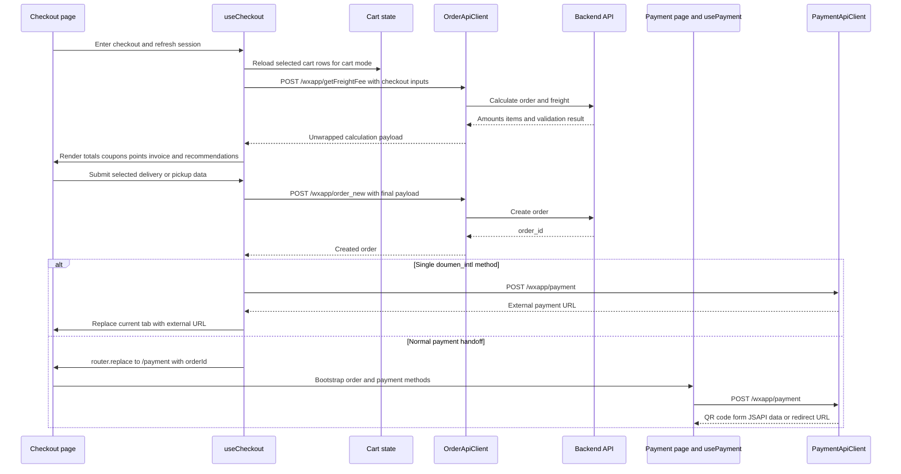
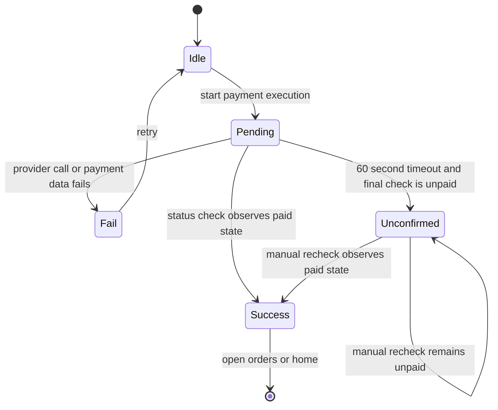

# Checkout, Order Creation, And Payment

## Scope And Entry Points

The workflow has two user-facing entrypoints:

- `/checkout` runs `useCheckout` and owns the one-page checkout session. It loads addresses, synchronizes the cart when `mode=cart`, calculates the order, and creates the order. `mode=fastbuy` and other modes use route/product context instead of assuming the current cart is the purchase set.
- `/payment?orderId=...` runs `usePayment` and owns payment-method loading, order information, payment execution, polling, timeout handling, and the result view. Checkout normally leaves for this page with `router.replace`, so the browser history does not retain the submit form as a payment step.

The API clients remain thin endpoint boundaries. `OrderApiClient` calls `/wxapp/getFreightFee` and `/wxapp/order_new`; `AddressApiClient`, `CouponApiClient`, and `StoreApiClient` supply checkout supporting data; `PaymentApiClient` calls payment-method, order-info, payment-initiation, and offline-transfer endpoints. The shared HTTP plugin adds global request context, serializes form bodies, unwraps successful response data, and classifies 422 validation errors as `VALIDATION_ERROR`.



*This sequence shows the normal calculate-to-create flow and the two post-creation payment handoffs.*

## Checkout Session

On mount and on activation after reuse, the checkout page loads addresses, refreshes the checkout session, and loads coupons. A cart-mode refresh first calls `loadCart({ silent: true })`, then recalculates; fast-buy does not load the cart because its purchase set comes from the fast-buy context. The selected address defaults to the server-marked default, or the first returned address when no default exists.

Address data comes from `GET /wxapp/member/addresslist` and is mapped by `OrderTransformer.toAddressModelList`. Coupon loading calls `GET /wxapp/user/newGetCardList` with the current selected amount or calculated total converted to cents. Coupon failures are logged and do not block checkout. Pickup store search first loads region data, resolves the selected province and city labels, then calls `GET /wxapp/store/list`; the first returned store is selected automatically.

Checkout state is reactive rather than persisted in a checkout store. It includes the form, selected address or pickup store, calculation result, coupon, point usage, recommendation rows, and separate general versus 422 checkout errors. Changing receipt type, address, coupon, or point usage triggers another calculation. The calculation transformer converts monetary response fields from cents to major units and marks `is_recommend` rows as checkout recommendations.

## Store Scope And Selection Invariant

The checkout distributor is resolved according to cart type:

- For `cart`, the selected rows' single normalized `distributorId` is authoritative, including `'0'` for a platform/self-operated store.
- For `fastbuy` or another non-cart mode, route `shopid` or `distributor_id` takes priority; a uniquely resolvable selected-item store is a fallback, followed by `resolveDistributorId()`.
- In BBC cart checkout, selecting products from more than one store is rejected before calculation or order creation. The user sees the error and no order request is sent. This is the single-store checkout invariant; B2C cart checkout does not apply this multi-store block.

This rule is intentionally separate from cross-store cart loading: the cart may contain many stores, but a BBC order submission must identify exactly one store. The same resolved distributor ID is used for calculation, order creation, payment-method scope, and the payment-page route when it is not `'0'`.

## Calculate And Build The Payload

`calculateOrderAmount` builds the calculation request and calls `POST /wxapp/getFreightFee`. The common fields are `distributor_id`, `cart_type`, `order_type: 'normal'`, `receipt_type`, `not_use_coupon`, and `point_use`. A selected coupon contributes `coupon_discount`.

Delivery modes shape the request differently:

- **Logistics:** requires a selected address and sends `receiver_name`, `receiver_mobile`, `receiver_state`, `receiver_city`, `receiver_district`, and `receiver_address`.
- **Pickup (`ziti`):** sends `pickup_location` from the selected store and uses the pickup name and phone as `receiver_name` and `receiver_mobile`. The page requires a store, name, and phone before submission.

The calculation response supplies item totals, freight, discounts, coupon information, point limits and deductions, invoice status, and delivery requirements. `OrderTransformer.toCalculateModel` converts cent amounts and carries recommendation rows into checkout items. Recommendations added on the checkout page are held separately from cart state and sent as `recommend_item_id: [{ item_id, num }]`; add/remove recalculates and restores the prior recommendation list if the recalculation fails.

A 422 from calculation represents a business validation condition such as insufficient stock or an invalid product. The composable passes `skipErrorCodes: [422]` to suppress the generic transport toast, stores the code and message in `checkoutError`, and leaves the page able to show its checkout error UI. Other failures populate the general checkout error. The HTTP plugin still classifies 422 as `VALIDATION_ERROR`; the composable is the boundary that turns it into an actionable checkout state.

## Order Creation

`createOrder(payType)` repeats the store invariant and requires an address for logistics. It posts to `/wxapp/order_new` with the calculation inputs plus `pay_type`. It repeats the logistics or pickup branch and includes coupon and point fields. When enabled, invoice data is added as `invoice_type` and `invoice_content`; non-string invoice content is JSON-serialized because the backend contract expects a string.

Recommendation rows must be included again in the create request, not only in calculation. They are not in the cart, and omitting them would make the created order and freight calculation disagree. `OrderApiClient.buildOrderRequestBody` JSON-serializes the recommendation array before the shared form serializer runs, preventing nested objects from becoming `[object Object]`.

Creation also suppresses generic 422 handling and returns `{ success: false, error }` with `checkoutError` populated for validation failures. Other failures populate the general error. On success the response order ID is read from `response.order_id` or `response.trade_info.order_id`.

## Handoff After Creation

Before creating an order, the checkout page loads the payment-method list for the current platform. If exactly one method exists and it is normalized as `doumen_intl`, checkout immediately calls `POST /wxapp/payment` and replaces the current tab with the returned external URL. A failed preflight or missing URL falls back to the regular payment page.

For all other successful creations, checkout calls `router.replace` to the localized `/payment` route with `orderId` and, when nonzero, `distributor_id`. The payment page disables keepalive, so stale payment state is not restored when returning to it. Without an order ID, it shows a link back to the cart instead of attempting payment.

## Payment Bootstrap And Execution Types

`usePayment` bootstraps order information and the payment-method list on mount or when the order ID changes. Payment methods come from `GET /wxapp/trade/payment/list` with `platform: 'pc' | 'h5'` based on viewport width and the order-derived distributor ID. If the order response does not expose a positive distributor ID, the composable tries order detail and then route query context. A deposit method also loads the balance; payment is disabled when the balance is below the order fee.

Selecting a method does not reload order information. When the primary action runs, the composable calls `POST /wxapp/payment` with `order_id`, `pay_type`, `return_url`, and `pay_channel`, then chooses execution from normalized pay type and runtime:

| Pay type and runtime | Execution | Result handling |
| --- | --- | --- |
| `deposit` | Deposit execution | Checks the order once, then treats the payment request as successful. |
| WeChat on PC | `qrcode` | Uses `code_url`, creates a QR image when needed, and starts polling. |
| WeChat in WeChat browser | `wechat_jsapi` | Invokes `WeixinJSBridge.getBrandWCPayRequest`, then polls. |
| WeChat on other H5 | `wechat_h5` | Opens the returned mobile redirect URL, then polls. |
| Alipay on PC | `alipay_form` | Submits the returned HTML form, then polls. |
| Alipay on H5 | `alipay_wap` | Submits the form or opens a redirect URL, then polls. |
| `doumen_intl` | `external_redirect` | Opens `pay_url` in the requested tab, keeps the payment page waiting, and polls. |
| Unknown type | `qrcode` fallback | Expects a usable code URL or enters failure. |

Bank-transfer methods are a separate page-level workflow. The page loads `/wxapp/order/offline/backaccount`, requires a bank account and at least one image, calls `/wxapp/payment` first, uploads voucher images through `aftersalesApiClient.uploadLocalImage`, then posts either `/wxapp/order/offline/upload/voucher` or `/wxapp/order/offline/update/voucher` when `has_check` is set. `PaymentApiClient` expands voucher URLs to indexed `voucher_pic[0]`, `voucher_pic[1]` form fields. Successful voucher submission navigates to the order detail page.

## Payment Lifecycle, Polling, And Timeout

The payment result starts at `idle`, becomes `pending` once payment execution begins, and becomes `success` when order polling observes one of the recognized paid or post-payment statuses, including `paid`, `success`, `pending_shipment`, `shipped`, or `completed`. Execution failures or missing required payment data become `fail` with an error message and a retry action.

Polling runs every 5 seconds and has a 60-second timeout. Each poll calls `GET /wxapp/order_new/{orderId}` with the selected pay type. An individual polling request failure is ignored so later polls can still observe a delayed provider callback. At timeout, polling stops and one final status check runs. If that check does not confirm payment, the result becomes `unconfirmed`, with no error message, rather than `fail`.

Timeout is deliberately unconfirmed because the browser has stopped observing within its bounded window; it has not established that the provider rejected or reversed the payment. The result view offers a manual recheck, reopening of an external payment URL, and navigation to orders. A later recheck can move the state to `success`. `retry` resets the local payment presentation to `idle`, clears payment artifacts and timers, and allows a new execution attempt.



*This state diagram distinguishes a known payment failure from a timeout whose final status is still unknown.*

## Focused Tests And Safe Changes

The highest-value focused tests are source-contract and composable behavior tests:

```bash
node --test app/pages/checkout/checkout-payment.behavior.test.js
node --test app/composables/usePayment.behavior.test.js
```

`checkout-payment.behavior.test.js` protects payment-method preflight, the `doumen_intl` current-tab redirect, creation-before-redirect ordering, and `router.replace` handoff. `usePayment.behavior.test.js` protects the 5-second interval, 60-second timeout, final status check, `unconfirmed` semantics, runtime-specific execution routing, bank-transfer wiring, indexed voucher fields, distributor-aware payment methods, and deposit balance handling. `usePayment.spec.ts` specifically exercises the external redirect waiting state, reopening, timeout-to-unconfirmed transition, and successful manual recheck.

When changing this workflow, preserve these boundaries:

- Keep BBC cart checkout single-store and use the same resolved distributor context through calculate, create, payment-method lookup, and payment navigation.
- Keep logistics and pickup fields mutually shaped; do not send pickup-only data as an address substitute or create an order without the required logistics address.
- Include checkout recommendation rows in both calculation and order creation, and preserve JSON serialization at the client boundary.
- Treat 422 as checkout validation state, not as a generic toast-only transport failure.
- Keep platform and browser detection in `resolvePaymentExecutionType`; payment providers require different browser mechanisms.
- Keep polling at 5 seconds with a 60-second bound and retain `unconfirmed` for unresolved status rather than presenting a false failure.
- Stop timers on success, timeout, retry, and unmount-related lifecycle paths, and keep the payment page non-keepalive to avoid stale state.

The broader request/error and response-unwrapping rules are documented in `/openwiki/integrations/http-and-backend-contract.md`; cart selection and distributor context are documented in `/openwiki/workflows/catalog-and-shopping-cart.md` and `/openwiki/concepts/runtime-domains.md`.
